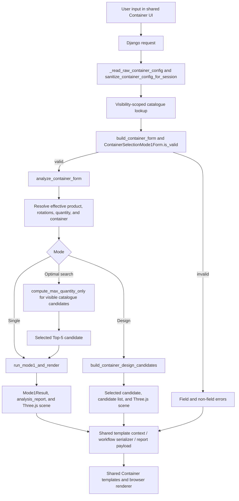

# KolliPack AI assistant architecture

Status: Session 10 explicit reviewed-proposal Apply and the anonymous Public Expert implemented locally; production/Railway enablement remains parked
Pilot: Container Selection / Box Selection
Last repository audit: 2026-10-09

## Purpose and authority

This document is the architectural source of truth for KolliPack's future contextual engineering assistant. It records the current Container Selection implementation and defines the boundary between deterministic KolliPack behavior and a future language model.

The governing rule is:

> KolliPack calculates. AI interprets, explains, and proposes actions.

The checked-out code remains authoritative for exact behavior. This document must be updated when the assistant contract, a tool adapter, action semantics, or data-disclosure policy changes.

The current phase includes the provider-free authenticated Tool Context endpoint, its compact result-fingerprint lifecycle, the offline fake provider, the external-transmission policy/throttle/readiness gate, Redis-backed shared throttle support, the first real OpenAI adapter for explicit local development, the authenticated `POST /assistant/ask/` bridge, the local contextual right-side UI for entitled Container Selection users, a bounded documentation-grounded Knowledge Context selected from an explicit approved-source registry, structured Container input-change proposal preview, and explicit application of one reviewed proposal to current inputs. It also includes a separate anonymous Public Expert capability on the marketing homepage and supported public calculators. The authenticated UI collects current allow-listed field state; the public UI never does. Apply is a separate authenticated application-side request: it performs fresh reconstruction and deterministic revalidation, updates inputs only after the user presses **Apply changes**, and stops without calling a provider or calculation engine. This phase does not enable production/Railway external AI, automatically calculate proposed outcomes, or persist conversation/proposal history.

## Architectural decisions

1. Deterministic tool engines and existing validation remain authoritative. An LLM is never a calculation or validation fallback.
2. The assistant receives a versioned, allow-listed, JSON-safe Tool Context built from current application state for every request. Conversation memory is not engineering state.
3. Each tool owns a small adapter from its existing service/result contracts into the shared Tool Context. The cross-tool assistant layer owns schema validation, orchestration, provider abstraction, security policy, and response handling.
4. Standalone, public, and workflow surfaces normalize into the same semantic contract. DOM prefixes, session keys, database IDs, and presentation-only strings are not part of that semantic contract.
5. An LLM may return only schema-validated proposals. It cannot mutate forms, workflow state, catalogues, database rows, or selected results.
6. A proposal is shown as a diff, tied to a fingerprint of the state from which it was created, and is revalidated against fresh application state before explicit user application.
7. Tool Context is an outbound-data allow-list, not a generic serializer. Making an object JSON-serializable does not make every field appropriate for an external provider.
8. Full placement arrays, Three.js scenes, image paths, and catalogue metadata are omitted by default. Compact deterministic facts are preferred.
9. The existing `AI_ASSISTANT` entitlement in `packagingapp/entitlements.py` is the commercial access authority when an assistant surface is eventually enabled.

## Current Container Selection architecture

### Component map

| Responsibility | Current path and entry point | Current role |
|---|---|---|
| URLs | `packagingapp/urls.py` | Routes `container_selection_mode1`, the public `container_selection_calculator`, PDF endpoints, and the application-owned assistant context endpoint. |
| Standalone/public orchestration | `packagingapp/views/container_selection.py::_build_container_selection_page_context` | Reads request state, scopes catalogue access, builds the form, calls the service, prepares template context, and stores report export payloads. |
| Standalone view | `packagingapp/views/container_selection.py::container_selection_mode1` | Renders the authenticated application surface. |
| Public calculator | `packagingapp/views/container_selection.py::container_selection_calculator` | Uses the same page-context builder and service with public-only catalogues and an optional example preset. |
| Form | `packagingapp/forms.py::ContainerSelectionMode1Form` | Defines types, minimum values, choices, defaults, and Design-specific required fields. |
| Default state | `packagingapp/tools/container/state.py::default_container_config` | Defines the canonical input/config keys and initial values. |
| Session-safe input normalization | `packagingapp/tools/container/serializers.py::sanitize_container_config_for_session` | Normalizes mode/shape and converts config values to JSON-safe strings/booleans. |
| Catalogue and analysis service | `packagingapp/tools/container/service.py` | Scopes catalogue queries, hydrates catalogue values, resolves effective inputs, ranks Top 5, invokes the engine, and builds analysis data. |
| Dimension contract | `packagingapp/tools/container/dimensions.py::resolve_external_carton_dimensions` | Resolves internal/external dimensions and records thickness provenance/assumption. |
| Presenter | `packagingapp/tools/container/presenter.py` | Builds compact selected-product and selected-container display summaries. |
| Selection engine | `packagingapp/utils/box_selection/engine.py` | Produces authoritative placements, capacity, Matplotlib output, and a JSON-safe Three.js scene. |
| Pilot algorithm | `packagingapp/utils/box_selection/box_selection_tool_arrays_2_origin_coordinates.py::MainBox` | Implements the bounded root plus Level 1 residual-space heuristic and authoritative R1/R2/R3 mapping. |
| Design generator | `packagingapp/utils/package_design_arrangements.py::build_canonical_design_arrangements` | Generates, normalizes, deduplicates, and ranks regular-grid Design candidates. |
| Shared UI contract | `packagingapp/views/container_selection.py::_build_shared_container_ui_contract` | Produces prefix-safe field names, IDs, and action names for standalone and workflow rendering. |
| Assistant workspace partial | `packagingapp/templates/assistant/_workspace.html` | Renders one reusable, entitled, external-AI-disclosed assistant panel outside engineering forms. |
| Assistant browser controller | `static/js/kollipack_assistant.js` | Serializes the server-declared semantic field map, calls the ask endpoint once, renders escaped text, handles stale state, and owns drawer accessibility. |
| Assistant workspace styling | `static/css/app_theme.css` | Provides the wide sticky workspace and narrower accessible drawer/full-width layouts without changing tool geometry. |
| Templates | `packagingapp/templates/container_selection_tool/` | Shared wrapper and partial tree used by standalone, public calculator, and Packaging Flow. |
| Browser coordination | `packagingapp/templates/container_selection_tool/partials/_container_selection_scripts.html` | Switches visible controls, sets explicit action values, hydrates hidden selection fields, and submits forms. It does not calculate results. |
| Three.js renderer | `static/js/container_threejs_viewer.js` and shared Three.js partials | Renders the server-produced scene. It is not an engineering authority. |
| Workflow orchestration | `packagingapp/views/full_packaging.py` | Adapts prefixed request data to the shared form/service, serializes results, manages pending/selected outputs, and persists JSON-safe workflow state. |
| Workflow Design payload | `packagingapp/tools/full_packaging/chain_optimizer.py::build_design_candidate_payload` | Converts a selected Design candidate to the standard downstream physical package payload. |
| Reports | `packagingapp/tools/container/export.py` plus export-payload builders in the view | Builds PDFs from normalized report data and a validated browser snapshot. |
| Entitlement | `packagingapp/entitlements.py::AI_ASSISTANT` | Existing Plus/Premium server-side access authority for assistant features. |
| Assistant context endpoint | `packagingapp/assistant/views.py::assistant_context` | Authenticated, entitlement-checked, CSRF-protected JSON boundary that reconstructs and returns validated current Tool Context without calculating. |
| Documentation knowledge layer | `packagingapp/assistant/knowledge.py` | Owns the approved source registry, heading-aware Markdown parser, mtime/size cache, deterministic lexical retrieval, authority metadata, strict bounds, and safe local trace. |
| Assistant ask endpoint | `packagingapp/assistant/views.py::assistant_ask` | Authenticated, entitlement-checked, CSRF-protected JSON boundary that reuses current Tool Context reconstruction and calls the gated external assistant service. |
| Reviewed-proposal token | `packagingapp/assistant/proposal_tokens.py` | Issues and validates the 10-minute Django-signed, timestamped, user/tool/surface/fingerprint/step-bound reference used only after a valid preview. |
| Assistant Apply endpoint | `packagingapp/assistant/views.py::assistant_apply_proposal` | Authenticated, entitlement-checked, CSRF-protected application-side boundary that reconstructs fresh state, revalidates the signed changes, updates inputs, and stops without provider or engine work. |
| Assistant workflow references | `packagingapp/assistant/workflow.py` | Creates and resolves opaque step references inside the current Django session; indexes and DOM prefixes are not accepted as authority. |
| Compact result lifecycle | `packagingapp/tools/container/assistant.py` | Validates versioned, bounded result snapshots carrying the semantic fingerprint, compact result, and compact alternatives only. |
| Assistant response contract | `packagingapp/assistant/contracts.py` | Strictly parses and validates versioned read-only responses, bounded messages, plain-text policy, and references to existing explanation facts. |
| Assistant service | `packagingapp/assistant/service.py::ask` | Revalidates and detaches Tool Context, selects the read-only capability/instructions and provider, invokes once with a bounded timeout, and normalizes failures. |
| Provider protocol and registry | `packagingapp/assistant/providers/base.py` and `providers/__init__.py` | Defines the minimum text-only provider call and an explicit provider allow-list. |
| Fake provider | `packagingapp/assistant/providers/fake.py` | Produces deterministic offline success and failure candidates for provider-independent tests. |
| OpenAI provider | `packagingapp/assistant/providers/openai.py` | Maps the bounded read-only request to one stateless Responses API call with separate Tool Context and Knowledge Context reference-data items, strict Structured Outputs, `store=false`, no tools, no retries, and normalized failures. |
| Local provider evaluation | `packagingapp/assistant/evaluation.py` | Builds deterministic empty/partial/invalid/ready/complete/stale Container contexts and the first bounded question set. |
| Local provider smoke command | `packagingapp/management/commands/smoke_openai_assistant.py` | Explicitly opt-in local call/evaluation path through readiness, Redis throttle, `ask_external`, and final response validation. |
| External configuration | `packagingapp/assistant/configuration.py` | Strictly reads server-owned provider/model/secret-reference/timeout/rate/privacy settings without exposing a credential value. |
| External transmission policy | `packagingapp/assistant/policy.py` | Builds the bounded external request, evaluates readiness, enforces authentication/entitlement/capability/privacy/cache/rate policy, and returns one allow/deny outcome before an adapter is called. |
| Assistant throttle | `packagingapp/assistant/throttle.py` | Implements the opaque per-user fixed window over an atomic shared counter backend and rejects process-local caches for deployment use. |
| Gated service entry | `packagingapp/assistant/service.py::ask_external` | Invokes only the server-configured allow-listed adapter after the central policy gate and existing Redis throttle allow the request. |

### Inputs and units

`ContainerSelectionMode1Form` exposes the following fields. Fields are optional at the Django field level where their requirement depends on mode or source; the service adds those conditional requirements.

| Field | Type / default | Unit or values | Required behavior and authority |
|---|---|---|---|
| `mode` | choice, `single` | `design`, `single`, `optimal` | Required. Normalized by `normalize_selection_mode`. |
| `action` | hidden string | explicit UI action | Drives refresh, analysis, search, and candidate selection. It is orchestration state, not engineering input. |
| `product_source` | choice, `manual` | `manual`, `catalogue` | Required. Catalogue values override posted product dimensions and rotations. |
| `product_catalogue_id` | choice | server-visible catalogue | Optional unless browsing a product catalogue. Choices are populated from `visible_product_catalogues`. |
| `selected_product_id` | hidden string | database reference | Optional. Looked up through a visibility-scoped queryset; it must never be sent to an LLM. |
| `product_l`, `product_w`, `product_h` | float, blank | mm; minimum `0.0001` | Required for manual analysis when the selected action needs a product; explicitly required by form cleaning in Design Mode. |
| `product_weight` | float, blank | treated as g by Container Selection; minimum `0` | Optional. Used for weight reporting, not geometry. See the unit discrepancy below. |
| `desired_qty` | integer, `1` | pieces; minimum `1` | Required for Design and Optimal semantics. Single-mode capacity does not use it to limit calculation. |
| `product_shape` | choice, `cuboid` | `cuboid`, `cylinder`, `bottle`, `pillow_bag` | Visual metadata only in Container Selection; the packing engine still uses the L/W/H cuboid envelope. |
| `r1` | boolean, `true` | length may be vertical | At least one of R1/R2/R3 is required by the service. |
| `r2` | boolean, `true` | width may be vertical | Catalogue products use the product record's rotation value. |
| `r3` | boolean, `true` | height may be vertical | Catalogue products use the product record's rotation value. |
| `container_source` | choice, `manual` | `manual`, `catalogue` | Required outside Design semantics. Design ignores a selected container. |
| `catalogue_id` | choice | server-visible packaging catalogue | Required for Optimal search. Choices use `visible_packaging_catalogues`. |
| `container_id` | hidden string | database reference | Required to analyze a catalogue candidate; must remain server-side. |
| `box_l`, `box_w`, `box_h` | float, blank | usable internal mm; minimum `0.0001` | Required for manual Single analysis. Fit always uses internal dimensions. |
| `box_thickness_mm` | float, blank | mm; minimum `0.0001` | Optional. Used only to derive external dimensions. A missing value invokes the shared 4 mm assumption. |
| `box_weight` | float, blank | treated as g by Container Selection; minimum `0` | Optional tare used for reporting, not fit. |
| `box_max_payload` | float, blank | g; minimum `0` | Optional informational payload comparison. It does not constrain engine capacity. |
| `selected_design_candidate_id` | hidden string | stable generated candidate ID | Selects one existing Design alternative; defaults to the first ranked candidate if absent or unknown. |

The authoritative orientation mapping is in `allowed_product_orientations`:

- R1 permits orientations with original length vertical.
- R2 permits orientations with original width vertical.
- R3 permits orientations with original height vertical.
- Symmetric duplicate permutations are removed deterministically.

The shared browser script keeps only transient DOM/form state. It sets one of the explicit actions `refresh`, `select_product`, `select_container`, `run_single`, `find_top5`, `select_candidate`, `run_design`, or `select_design_candidate`, then submits the existing form through the shared scroll-preservation helper. It does not keep a second calculation state in JavaScript or browser storage.

### Known unit discrepancy

Container Selection's templates, presenter, report service, presets, and workflow helper treat product weight, packaging tare, and manual payload as grams. `PackagingMaterial.part_weight` is also consumed as grams by these Container paths. However:

- `packagingapp/models.py` comments `PackagingMaterial.part_weight` as kilograms;
- `packagingapp/views/packaging_catalogue.py` describes the Excel field as `part_weight in kg`;
- Transport and Corrugated consumers also use kilogram-oriented interpretations.

This is an existing cross-tool semantic conflict, not an assistant issue. Tool Context must not label a catalogue `part_weight` as g or kg until the canonical data meaning and any migration/conversion policy are resolved. Manual Container fields have an explicit current UI contract of grams.

### Validation and normalization

Validation is layered rather than located in one function:

1. `default_container_config` establishes every supported key.
2. `_read_raw_container_config` reads GET/POST values and normalizes booleans and the legacy `tool_mode` alias.
3. `sanitize_container_config_for_session` normalizes mode and shape, keeps booleans as booleans, and converts scalar input values to strings.
4. `get_selected_product` and `get_selected_material` rehydrate hidden IDs only through catalogues visible to the current user. Public calculator calls intentionally use `user=None`, restricting it to public catalogues.
5. `build_hydrated_post_data` replaces posted dimensions, rotations, and applicable quantities with authoritative catalogue values.
6. `ContainerSelectionMode1Form.is_valid()` enforces types, choices, numeric minimums, and Design-specific required fields.
7. `analyze_container_form` enforces conditional source/action rules: a selected product or complete manual dimensions, at least one orientation, a selected/manual container for Single, a packaging catalogue for Optimal, and a selected Top-5 candidate before rendering it.
8. Engine functions remain defensive: invalid/non-positive Selection dimensions yield no placements; Design arrangement generation rejects non-positive product dimensions.
9. `resolve_external_carton_dimensions` validates the internal dimension triplet and applies one complete external-dimension strategy rather than mixing axes.

Future AI proposals should reuse this path. The proposal adapter may map canonical assistant field names to a copy of the current config, but it must then instantiate the same form, use the same visibility-scoped catalogue resolution, and invoke shared conditional validation. It must not reproduce minimum values or source rules in a second AI-only validator.

One improvement is warranted when actions are implemented: extract the current conditional input checks from `analyze_container_form` into a pure shared validator used by both analysis and proposal validation. That extraction should preserve behavior and receive regression coverage; it is not part of this architecture session.

### Current data flow



The public calculator follows the same graph, with public-only catalogue queries and optional initial preset data. Packaging Flow adds prefix adaptation before the form and JSON-safe serialization after the service; it does not use another Container engine.

### Calculation authority and result representation

#### Selection and Optimal modes

`packagingapp/utils/box_selection/engine.py` returns a frozen `Mode1Result` containing:

- `max_quantity`: `len(placements)`, the authoritative geometric capacity;
- `placements`: immutable `Placement` objects with origin, dimensions, level, and region type;
- `threejs_scene`: JSON-safe container dimensions, product cuboids, residual subbox metadata, and orientation indexes;
- `image_rel_path`: a relative Matplotlib output path.

`calculate_placements` performs one root `MainBox` call, keeps the root main grid, evaluates up to three root residual regions with one complete child `MainBox` call each, and stops at that bounded depth. `compute_max_quantity_only` counts the exact same placement collection. `draw_limit` affects only the rendered slice for a selected Optimal result; it does not change capacity.

The engine is the authority for fit, placements, rotations, and quantity. Three.js renders server-produced coordinates and dimensions.

`build_container_analysis_report` derives a JSON-safe presentation/report structure from the authoritative result and effective inputs:

- internal and external dimensions plus thickness provenance;
- requested and maximum quantity and remaining geometric capacity;
- current and maximum volume utilization;
- product, container, current product, and maximum product volumes;
- optional product weight, tare, payload, net weight, total weight, and payload usage;
- display strings and `has_*` availability flags.

These weight/payload metrics are informational. The current engine does not reduce `max_quantity` for payload, packaging strength, cushioning, handling, or product protection.

`PackagingMaterial` currently has no confirmed maximum-payload field. Manual Container input can supply `box_max_payload`; for a catalogue item, the service probes several future-compatible attribute names, which are absent from the current model, so catalogue payload status is normally unavailable.

Optimal mode ranks visible packaging materials that meet desired geometric quantity by descending desired-quantity volume usage, then ascending container volume. The service returns the top five rows. In standalone request context those rows still contain `PackagingMaterial` model objects; the workflow converts them to primitive `material_id`, quantity, usage, and volume fields before session storage.

#### Design Mode

Design Mode does not search an existing container. It uses:

- product dimensions;
- desired quantity;
- R1/R2/R3 permissions;
- optional product weight for net-content weight;
- optional thickness for external-dimension derivation.

`build_canonical_design_arrangements` raises the request to the next supported smooth quantity, enumerates ordered three-axis factor arrangements for every allowed orientation, normalizes horizontal axes so length is not shorter than width, deduplicates identical final bounding boxes, and ranks candidates by:

1. cubicity descending;
2. additional capacity ascending;
3. internal volume ascending;
4. stable canonical and representative tie-breakers.

`build_container_design_candidates` adds stable candidate IDs, ranks, internal dimensions, arrangement/orientation metadata, and JSON-safe render data. The service adds external dimensions, the thickness assumption, and optional net-content weight. A requested stable candidate ID selects that row; otherwise the first ranked row is selected.

The reported Design efficiency is `1.0` because each candidate is the exact regular-grid bounding box. It is not a measured real-world carton utilization allowance. Container tare and payload are intentionally absent from Design results.

#### Engineering truth versus presentation

| Data | Classification |
|---|---|
| Placements, allowed orientations, geometric maximum, Design candidate geometry | Deterministic engineering truth from the engine/generator. |
| Internal/external dimension resolution and thickness assumption | Deterministic shared service contract. |
| Top-5 feasibility and ordering | Deterministic service result derived from engine capacity and volume. |
| Volume and weight arithmetic in `analysis_report` | Deterministic derived facts, subject to complete and correctly interpreted inputs. |
| Display strings, rounded percentages, summary labels | Presentation only. Tool Context should use raw numeric fields and explicit units/scales. |
| Three.js colors, RSC flaps, camera, product shape mesh | Visualization only. Product shape does not change Container fit. |
| Matplotlib/media paths and browser snapshot | Report/visualization transport data, not assistant context. |

### State and session behavior

#### Standalone and public surfaces

Standalone inputs are reconstructed from each GET/POST request. There is no general `container_selection_config` session object. The calculation result and model/query objects live in the request/template context.

Successful calculations store compact export payloads under:

- `container_selection_last_export`;
- `container_selection_single_export`;
- `container_selection_optimal_export`;
- `container_selection_design_export`.

Those payloads contain report values and relative media paths. They exist to support PDF export and are not an appropriate general assistant state store.

The public calculator uses the same view builder with public catalogue visibility and can run a server-defined example on initial GET.

#### Packaging Flow

Packaging Flow uses `full_packaging_mode_session` or a case-specific derivative. A Container step begins with primitive config, messages, compact results, Top-5 rows, Design candidates, `pending_result`, and `selected` fields.

`_process_container_step`:

1. reads prefix-safe fields;
2. applies an inherited upstream payload for non-first steps;
3. sanitizes the config;
4. constructs the same `ContainerSelectionMode1Form` through a normalized request stub;
5. calls `analyze_container_form`;
6. converts dataclasses/model references into JSON-safe dictionaries and IDs;
7. builds a physical downstream package payload using external carton dimensions.

Catalogue IDs are stored as strings and rehydrated for a request. Product/model instances and QuerySets used for rendering are transient and must not enter the session.

The actual current inheritance rule in `_effective_step_output` prefers `pending_result` and falls back to explicitly `selected`. Thus a newly calculated physical result can prefill the next step before the user presses “Use this result”; `selected` still records the explicit accepted result. An assistant contract must preserve and label this distinction instead of collapsing both to “selected.”

For non-Design Container output, generic workflow `length`, `width`, and `height` are resolved external dimensions; `internal_*` fields preserve usable fit dimensions. For Design output, `build_design_candidate_payload` preserves desired/design quantities, stable candidate ID, arrangement, orientation, external dimensions, and optional net content weight.

Full scenes and candidate lists can be large. They are JSON-safe today, but the assistant should receive compact summaries rather than blindly copying the workflow step.

### Other consumers assessed

- The public Box Size Calculator is a true shared consumer of the form, service, result partials, and renderer.
- Packaging Flow is a shared consumer with prefix and session adapters.
- PDF export consumes normalized report data and a validated Three.js snapshot; it must not become an assistant input source.
- Multi-product Container Selection calls the authoritative geometry engine but currently duplicates Top-5 ranking and catalogue serialization in `packagingapp/views/multi_product_container.py` instead of consuming `packagingapp/tools/container/service.py`. It also has its own JSON endpoints. Its draw endpoint resolves posted product/material row IDs with unscoped `get_object_or_404` calls rather than the visibility-scoped catalogue helpers used by the shared Container service. This existing divergence and security boundary must not be copied into the assistant architecture; it merits a separate review before batch-assistant support. Supporting the batch tool is out of scope for the pilot.

## Existing patterns to reuse

| Existing pattern | Reuse for the assistant |
|---|---|
| `default_container_config` | Canonical list of current Container input keys and defaults. |
| `sanitize_container_config_for_session` | Input normalization before form construction and workflow persistence. Do not use it as the outbound privacy allow-list. |
| `normalize_selection_mode` and `normalize_product_shape` | Shared normalization for current and proposed values. |
| `ContainerSelectionMode1Form` | Primary type, choice, and range validation. |
| Visibility-scoped catalogue service functions | Rehydrate catalogue references server-side under the requesting user's access rules. |
| `analyze_container_form` / `analyze_container_capacity` | Existing deterministic service entry points. Context construction should consume their results, not recalculate in the assistant. |
| `resolve_external_carton_dimensions` | One authoritative internal/external dimension and assumption contract. |
| JSON-safe analysis reports, scenes, and workflow payloads | Proven examples of primitive contracts. Tool Context should select from them rather than serialize arbitrary objects. |
| Shared `container_ui`/`container_values` wrapper contract | Future UI panel can observe the same semantic fields across standalone/workflow without knowing hard-coded DOM IDs. |
| `pending_result` versus `selected` | Preserve calculation versus explicit workflow-selection status in context. |
| Stable Design `candidate_id` | Reference a selected alternative without relying on rank or list position. IDs may remain in application state; only non-database candidate IDs are safe to send when required. |
| `feature_required` and `AI_ASSISTANT` | Enforce paid assistant access server-side before provider work. |

The Corrugated tool has a recursive `json_safe` helper, and several tools have serializers. These are useful implementation examples but should not be applied to arbitrary objects for LLM disclosure. The assistant requires explicit field selection.

## Proposed assistant architecture

### Boundaries and responsibilities

```mermaid
flowchart LR
    UI[KolliPack UI and current application state] --> APP[Django view / workflow orchestrator]
    APP --> VAL[Existing form and domain validation]
    VAL --> ENG[Deterministic KolliPack engine/service]
    ENG --> RES[Authoritative tool result]
    RES --> ADAPT[Tool-specific context adapter]
    VAL --> ADAPT
    ADAPT --> CTX[Versioned minimal Tool Context]
    CTX --> ASVC[Assistant service]
    ASVC --> PROV[Replaceable LLM provider]
    PROV --> RESP[Schema-validated answer or proposal]
    RESP --> UI

    RESP -->|proposed input changes only| ACT[Allow-listed action validator]
    ACT -->|validate against fresh state| PREVIEW[User-visible diff]
    PREVIEW -->|explicit Apply| FORM[Existing form / workflow config]
    FORM --> VAL
```



The implemented call shape is one application-level entry point:

```python
assistant_service.ask(
    message=user_message,
    tool_context=container_context,
)
```

Authentication and entitlement remain outside the service boundary, so no user object or account metadata reaches a provider. Views must not import a provider SDK, build prompts, parse arbitrary provider JSON, or perform tool calculations.

### Recommended module layout

The implemented modules and reserved future boundaries are:

```text
packagingapp/
    assistant/
        contracts.py       # versioned cross-tool schemas and validation
        views.py           # authenticated provider-free context endpoint
        workflow.py        # opaque current-session workflow step references
        context.py         # future cross-tool registry and assembly policy
        actions.py         # allow-list, proposal validation, stale-state checks
        service.py         # ask orchestration, timeouts, failure mapping
        prompts.py         # provider-neutral system/task instructions
        privacy.py         # outbound allow-list/redaction and audit metadata
        providers/
            base.py        # provider protocol
            fake.py        # deterministic offline Session 4 provider
            <provider>.py  # SDK-specific request/response mapping
    tools/
        container/
            assistant.py   # Container state/result -> Tool Context adapter
```

The tool adapter belongs beside the tool's state/service/presenter because it understands Container semantics. Shared assistant code must not import `MainBox` or implement packaging calculations.

`contracts.py` should start with standard Python/Django facilities already in the repository unless a later provider integration justifies a narrowly chosen schema dependency. Provider-native structured output is helpful but does not replace server-side schema validation.

## Tool Context Contract

### Implemented Session 2 boundary

The first production Tool Context foundation is implemented in:

- `packagingapp/assistant/contracts.py` for schema versioning, canonical JSON,
  SHA-256 fingerprints, strict type/privacy checks, and deterministic size
  limits;
- `packagingapp/tools/container/assistant.py` for the Container-specific
  allow-list and standalone/public/Packaging Flow adapters;
- `packagingapp/tools/container/service.py::inspect_container_readiness` for
  shared, calculation-free inspection of the current mode/source
  prerequisites after Django form validation.

The concrete `1.0` contract keeps every approved top-level section. `result`
is `null` for empty, partial, invalid, ready, and stale states so an absent or
old result cannot be mistaken for a zero/current calculation. Validation uses
`valid`, `incomplete`, or `invalid`; calculation state remains the approved
`empty`, `partial`, `invalid`, `ready`, `complete`, or `stale` value.

The current limits are five compact alternatives, 20 validation errors, 20
warnings, 32 explanation facts, 24 allowed proposal fields, 512 characters per
string, 12 nested levels, and 64 KiB for the complete canonical context.
Oversized or unsupported structures fail validation. Alternative/error caps
are explicit and produce a stable warning when the adapter limits a supported
source list.

The state fingerprint hashes only normalized semantic Container inputs and
mode. It excludes surface, action/button state, DOM/session/request data,
identity, database IDs, presentation strings, paths, scenes, and placements.
For Optimal mode, callers may supply the already visibility-scoped material
set; the context then includes an opaque digest and count derived only from
candidate dimensions, thickness, and ranking volume. IDs, names, owners, and
ambiguous weights do not enter that digest. A same-request result binds to the
current fingerprint. Any result retained beyond that request must carry its
original fingerprint; a mismatch produces `stale` and suppresses both result
and alternatives.

Catalogue `PackagingMaterial.part_weight` remains withheld. The adapter emits
only a stable ambiguity warning and never labels that value as grams or
kilograms. Manual Container weight/payload values keep their existing gram
contract and remain explicitly informational.

### Implemented Session 3 endpoint boundary

The first application-owned endpoint is:

```text
POST /assistant/context/
Content-Type: application/json
```

It requires the normal authenticated Django user and the existing
`AI_ASSISTANT` entitlement. Django's normal CSRF middleware remains active.
Authorization and entitlement checks happen before state reconstruction.

Standalone requests contain exactly:

```json
{
  "tool": "container_selection",
  "surface": "standalone",
  "state": {"...": "allow-listed current Container form values"}
}
```

Workflow requests add one `step_ref`. The reference is a random opaque value
owned by the Packaging Flow step in the current Django session. The endpoint
does not accept a workflow index, DOM prefix, case/session key, or database
primary key as step authority. It returns only the requested Container step.

Request state is untrusted. Only current Container config keys and scalar JSON
values are accepted, with a 32 KiB request limit. Catalogue references are
rehydrated through the existing visibility-scoped Container service queries;
posted dimensions cannot replace catalogue-authoritative values. For later
workflow steps, the endpoint reapplies Packaging Flow's existing inherited
payload mechanism after merging current browser state, so inherited product
dimensions and provenance remain authoritative.

Successful responses have the application-owned shape
`{"ok": true, "context": <validated Tool Context 1.0>}`. Failures use
`{"ok": false, "error": {"code": "...", "message": "..."}}` with no
provider concepts or internal exception details. The strict Tool Context
validator is run immediately before the response, retaining the 64 KiB
canonical context limit.

The endpoint never calls `analyze_container_form`, capacity-only analysis,
`MainBox`, Optimal search, Design generation, rendering, or PDF export. Valid
inputs with no matching retained result therefore return `ready` rather than
triggering hidden work.

Normal authenticated/entitled Container calculations create a compact
tool-owned result snapshot. It is schema-versioned, capped at 32 KiB, and
contains only the Tool Context schema version, tool, mode, semantic state
fingerprint, compact result, and at most five compact alternatives. It never
contains placements, scenes, report/export payloads, forms, model objects,
catalogue identity, workflow blobs, or conversation history. A matching
fingerprint returns `complete`; a mismatch returns `stale` with `result = null`
and no alternatives. Packaging Flow stores the same snapshot on the relevant
JSON-safe step while preserving its separate pending/selected state.

The repository has no reusable request-throttling facility. Session 3 adds no
dependency solely for a provider-free endpoint. Per-user rate limiting remains
required before an external provider is enabled.

### Contract goals

The contract must be:

- versioned and JSON-safe;
- small enough to rebuild for every assistant request;
- semantic rather than tied to HTML names or database layout;
- valid for empty, partial, invalid, calculated, and workflow states;
- explicit about units, missing values, assumptions, and provenance;
- sufficient for both input help and result explanation;
- incapable of granting actions by merely describing them.

### Recommended Container pilot shape

The following is a target semantic shape, not an implemented payload:

```json
{
  "schema_version": "1.1",
  "tool": {
    "id": "container_selection",
    "surface": "standalone",
    "mode": "single",
    "state_fingerprint": "sha256:...",
    "calculation_status": "complete"
  },
  "inputs": {
    "product": {
      "source": "manual",
      "dimensions": {
        "length": {"value": 180.0, "unit": "mm", "status": "valid"},
        "width": {"value": 120.0, "unit": "mm", "status": "valid"},
        "height": {"value": 80.0, "unit": "mm", "status": "valid"}
      },
      "weight": {"value": 450.0, "unit": "g", "status": "valid"},
      "shape": "cuboid",
      "allowed_vertical_axes": ["length", "width", "height"]
    },
    "request": {"desired_quantity": {"value": 24, "unit": "pcs", "status": "valid"}},
    "container": {
      "source": "manual",
      "internal_dimensions": {
        "length": {"value": 600.0, "unit": "mm", "status": "valid"},
        "width": {"value": 400.0, "unit": "mm", "status": "valid"},
        "height": {"value": 320.0, "unit": "mm", "status": "valid"}
      },
      "thickness": {"value": 4.0, "unit": "mm", "status": "assumed"},
      "tare_weight": {"value": 950.0, "unit": "g", "status": "valid"},
      "max_payload": {"value": 20000.0, "unit": "g", "status": "valid"}
    }
  },
  "input_definitions": {
    "product.dimensions.length": {
      "label": "Product length",
      "type": "number",
      "canonical_unit": "mm",
      "minimum_exclusive": 0,
      "editable": true
    }
  },
  "validation": {
    "status": "valid",
    "errors": []
  },
  "assumptions": [
    {"code": "external_dimensions_default_thickness", "value": 4.0, "unit": "mm"},
    {"code": "product_shape_uses_cuboid_envelope"}
  ],
  "restrictions": [
    {"code": "orthogonal_placements_only"},
    {"code": "bounded_residual_heuristic"},
    {"code": "payload_not_capacity_constraint"}
  ],
  "result": {
    "kind": "selection",
    "max_quantity": {"value": 24, "unit": "pcs"},
    "requested_quantity": {"value": 24, "unit": "pcs"},
    "remaining_geometric_capacity": {"value": 0, "unit": "pcs"},
    "volume_utilization": {"value": 0.675, "scale": "ratio"},
    "payload_usage": {"value": 0.54, "scale": "ratio", "status": "available"}
  },
  "alternatives": [],
  "workflow": null,
  "warnings": [],
  "explanation_facts": [
    {"code": "geometric_capacity_source", "value": "authoritative_placements"}
  ],
  "allowed_proposals": [
    "product.dimensions.length",
    "product.dimensions.width",
    "product.dimensions.height",
    "product.weight",
    "request.desired_quantity",
    "product.allowed_vertical_axes",
    "container.internal_dimensions.length",
    "container.internal_dimensions.width",
    "container.internal_dimensions.height"
  ]
}
```

The example's numbers illustrate shape only. Production values must come from the current form/service result. Catalogue weight fields must be withheld or marked unit-unknown until the repository's `part_weight` unit conflict is resolved.

### Section provenance and disclosure policy

| Section | Purpose | Source | Existing or transformed | Send to LLM? | Sensitivity / minimization |
|---|---|---|---|---|---|
| `schema_version` | Contract compatibility | Assistant contract constant | New | Yes | None. |
| `tool.id` | Select tool vocabulary and prompt behavior | Adapter registration | New normalized value | Yes | Use stable semantic ID only. |
| `tool.surface` | Distinguish standalone, workflow, or public behavior | View/orchestrator | New normalized value | Yes | Do not include URL, DOM prefix, or step database data. |
| `tool.mode` | Explain Single, Optimal, or Design semantics | Normalized config/form | Exists | Yes | None. |
| `state_fingerprint` | Reject stale proposals and correlate without exposing state | Hash of canonical allow-listed state | New transformation | Normally no; echo through structured proposal if required | Never use session/user IDs in the hash input. Prefer an opaque short-lived server token if available. |
| `calculation_status` | Express empty/partial/invalid/complete/stale state | Form validity plus result presence | New transformation | Yes | None. |
| `inputs` | Current effective engineering inputs | Sanitized config, cleaned form data, selected visible catalogue objects, inherited workflow payload | Exists across several structures; normalize | Yes, minimum required | Omit database IDs, owners, image/file fields, and unrelated catalogue metadata. |
| `input_definitions` | Give types, units, choices, conditions, and editability | Form metadata plus a small tool-owned semantic map | Partly exists; transformation needed | Yes for fields relevant to the request | Do not dump Django widgets, validators, or internal field names wholesale. |
| `validation` | Explain missing/invalid fields without asking the LLM to validate | Form errors and shared conditional checks | Exists; normalize error codes/messages | Yes | Exclude stack traces and submitted secrets. |
| `assumptions` | State deterministic assumptions already applied | Dimension contract, domain rules, mode/result metadata | Partly exists; normalize | Yes | Only facts KolliPack can assert. |
| `restrictions` | State algorithm and model boundaries | Domain constants/rules and current mode | New normalized list from established behavior | Yes | Keep concise; no source code or internal trace. |
| `result` | Explain the current selected calculation | `Mode1Result`, `analysis_report`, or selected Design candidate | Exists; compact transformation | Yes | Raw numbers with explicit units/scales; omit media paths and full placement arrays by default. |
| `alternatives` | Compare Top-5 or Design alternatives | Top-5 service rows or Design candidate list | Exists; sanitize and cap | Yes when asked or in result mode | Use anonymous semantic labels such as `Candidate 1`. Private names, part numbers, descriptions, and owner data are prohibited by the initial external policy. |
| `workflow` | Explain inherited, pending, and selected state and downstream role | Packaging Flow step and adjacent normalized payloads | Exists; transformation needed | Yes when the current surface is workflow | Include only relevant adjacent-step summaries, not the entire session. |
| `warnings` | Surface current service notices and deterministic incomplete-data warnings | Form/service messages and adapter checks | Exists/derived | Yes | Do not convert uncertain model interpretations into warnings. |
| `explanation_facts` | Give deterministic reasons and comparisons | Classification below | Mixed | Yes | Include basis/status, never unsupported causal claims. |
| `allowed_proposals` | Tell the response schema which fields may be proposed | Server-side action policy for current mode/source | New | Yes if input proposals are enabled | Descriptive only; server enforcement remains authoritative. |

### Empty, partial, invalid, and stale state

The adapter must produce context even when no calculation exists:

- `empty`: defaults only; no meaningful user values;
- `partial`: at least one user/effective value exists but analysis prerequisites are incomplete;
- `invalid`: existing form/shared validation has errors;
- `ready`: valid inputs exist but the calculation has not run for this fingerprint;
- `complete`: result fingerprint matches current inputs and selected candidate;
- `stale`: a prior result exists but current inputs no longer match it.

Do not represent a missing result as a zero result. Do not let an LLM infer that a previous result still applies after input changes.

### Standalone and workflow normalization

The semantic `inputs` and `result` sections should be identical for an equivalent fixture. Surface differences belong in:

- `tool.surface`;
- `workflow.input_origin` (`manual`, `catalogue`, or `inherited`);
- `workflow.result_state` (`pending` or `selected`);
- `workflow.step_type` and a request-local ordinal if the user needs orientation within the flow;
- compact upstream/downstream quantity summaries.

Never send the session key, step DOM prefix, full workflow object, or unrelated step data.

### Context lifecycle and freshness

Build Tool Context on the server from fresh state for every assistant request. The preferred implementation sequence is:

1. Read the current form/workflow state.
2. Normalize and validate through the existing tool path.
3. Attach the already-produced authoritative result when its input fingerprint matches.
4. Otherwise mark the result absent/stale; do not silently reuse it.
5. Create an allow-listed context and verify `json.dumps(context)`.
6. Apply the privacy filter and size limits.
7. Send the context to the assistant service.

Standalone result persistence remains deliberately tool-specific rather than general-purpose. Session 3 stores only the compact, versioned Container result snapshot described above and does not use report export payloads as assistant state. It does not store dataclasses, placements, model objects, whole scenes, or conversation memory.

## Deterministic explanation facts

Each fact should have a stable `code`, a primitive `value`, optional units/scale, and a basis such as `engine_output`, `service_derivation`, or `instrumentation_required`. The LLM may phrase a fact but must not change its value or certainty.

### A. Already directly available

- Current mode, source choices, effective dimensions, desired quantity, product shape, and R1/R2/R3 permissions.
- Form errors, service messages, and Design additional-capacity notice.
- Maximum geometric quantity and authoritative placement count.
- Internal and resolved external dimensions, thickness used, whether thickness was assumed, and external-dimension source.
- Requested/current quantity, remaining geometric capacity, raw volume values, rounded utilization metrics, and availability flags.
- Product weight, packaging tare, payload capacity, net/total weight, and payload usage when present and when their unit semantics are known.
- Top-5 rank, geometric capacity, desired-quantity volume usage, and container volume for returned candidates.
- Design desired quantity, smooth design quantity, additional capacity, arrangement, orientation, rows/columns/layers, internal/external dimensions, cubicity, volume, rank, and selected stable candidate ID.
- Workflow input origin, pending versus selected result, units per parent, total base units, and resolved external physical dimensions.

### B. Safely derivable from existing deterministic outputs

- `requested_quantity_fits_geometrically`: compare a meaningful requested quantity with maximum geometric quantity.
- `geometric_shortfall` and `remaining_geometric_capacity`: bounded integer differences.
- `payload_check_status` (`within`, `exceeded`, `unknown`) from payload usage, only after unit semantics are confirmed.
- `weight_data_complete`: combine existing `has_*` flags.
- `external_dimensions_are_estimated`: map `box_thickness_assumed` and `external_dimension_source`.
- `allowed_orientations`: call the authoritative `allowed_product_orientations` mapping; do not recreate its permutation rules.
- `top5_ranking_basis`: for returned rows, compare their existing usage and volume values according to the service's deterministic sort.
- `result_visualization_is_limited`: when Optimal render count is the desired quantity but maximum capacity is higher.
- `design_quantity_exceeds_request`: compare existing Design fields.
- `result_state_is_pending`: read the workflow state explicitly.

These derivations belong in the tool adapter or a deterministic helper with unit tests, not in prompts.

### C. Requires new deterministic instrumentation

- A general `limiting_constraints` claim such as `geometry`, `payload`, `strength`, or `protection`. The current capacity engine is geometric and does not combine all constraints.
- `payload_limited_capacity` for catalogue inputs until `part_weight` units are resolved and payload becomes an explicit authoritative capacity rule.
- Reasons every rejected catalogue item failed, including axis-specific or orientation-specific rejection details. The current Top-5 path keeps only accepted scores.
- Why one `MainBox` orientation/partition beat every alternative, including score/tie details across root and residual regions.
- Candidate rejection facts such as `width_exceeded` or `orientation_forbidden` unless the engine emits a structured rejection result.
- Sensitivity statements such as “allowing R2 adds N units” unless KolliPack deliberately runs and labels comparison calculations.
- Physical protection, cushioning, compression, stability, material strength, manufacturability, or handling conclusions not calculated by the active tool.
- A causal explanation of why a Design candidate is best beyond its published deterministic ranking keys.

Instrumentation should be added only to the deterministic service/engine and covered by engine tests. It must not alter mode behavior merely to improve an AI explanation.

### D. Must not be exposed as explanation facts

- LLM guesses, chain-of-thought, hidden prompts, provider metadata, or confidence phrased as engineering truth.
- User IDs, usernames, email addresses, session keys/cookies, catalogue owner IDs, database primary keys, subscription records, or access-control internals.
- API keys, secrets, environment variables, stack traces, filesystem paths, media-root paths, or signed storage URLs.
- Arbitrary catalogue descriptions or uploaded document/image contents unless a future feature has an explicit disclosure and consent policy.
- Raw QuerySets/models, full session objects, unrelated Packaging Flow steps, or full Three.js/placement arrays by default.
- Unsupported claims that a result is globally optimal, safe, compliant, manufacturable, or a substitute for physical validation.

## Input action architecture

### Proposal schema

The Session 9 model response may propose only an allow-listed input change such as:

```json
{
  "schema_version": "1.0",
  "type": "propose_input_changes",
  "state_fingerprint": "sha256:...",
  "changes": [
    {
      "field": "product.dimensions.length",
      "value": 320.0,
      "unit": "mm"
    }
  ],
  "summary": "Set the product length to the value you provided."
}
```

The schema rejects unknown action types, unknown fields, unexpected keys,
invalid units, non-finite numbers, overlong text, and excessive change counts.

### Action boundary

`packagingapp/assistant/actions.py` owns the cross-tool protocol. The
Container-specific map in
`packagingapp/tools/container/assistant_actions.py` maps semantic fields to
current config/form keys. The boundary performs:

1. parse and strict schema validation of the untrusted model response;
2. entitlement, authentication, CSRF, rate-limit, and current-tool checks;
3. state-fingerprint comparison against fresh application state;
4. action/field allow-list enforcement for current mode and source;
5. explicit, limited unit conversion into the canonical mm/g/pcs units;
6. merge into a copy of current config, never the live state;
7. existing form and shared conditional validation;
8. return a user-visible diff with field-level validation results;
9. on explicit Apply, repeat steps 2–7 against fresh state;
10. update only the existing form/workflow config, then let the normal user-triggered calculation invoke the engine.

No proposal handler calls arbitrary Python, accepts a function name from the LLM, writes catalogue records, selects a Design result, or runs the engine as a hidden side effect.

### Catalogue and inherited fields

Catalogue records and inherited upstream outputs are authoritative sources, not editable copies. A proposal must not overwrite their database values.

The safest initial policy is:

- allow advice about a catalogue/inherited value;
- reject a direct proposal to edit that effective value while its source remains `catalogue` or `inherited`;
- if product design approves it later, offer an explicit atomic proposal to switch the source to manual and populate a complete manual field set;
- show that source change prominently before Apply;
- never change catalogue ownership or selected record IDs through the assistant.

## AI service and provider boundary

`assistant.service.ask` should accept a validated Tool Context and return one of a small set of application-owned response types:

- explanatory text with cited context fact codes;
- clarifying questions without state mutation;
- a structured input-change proposal;
- a safe unavailable/error response.

Provider adapters should be responsible only for authentication, request formatting, structured-output invocation, timeout/retry policy, and mapping the provider response back to the application schema. They must not know Django requests, catalogue models, workflow sessions, or engine functions.

The service must:

- select prompts by version and assistant capability;
- bound message/context size;
- provide only allowed tools/actions, if any;
- validate every response server-side;
- treat prose and structured fields as untrusted output;
- escape rendered text and prohibit provider-supplied HTML;
- fail closed when the provider is unavailable or malformed;
- keep deterministic tools usable when AI is down;
- record privacy-safe operational metrics without logging raw engineering prompts by default.

Provider replacement should affect only the provider adapter and configuration, not views, tool adapters, forms, or engines.

### Implemented Session 4 read-only service

`packagingapp.assistant.service.ask` now implements the first callable service boundary. It accepts only:

- one user message;
- one Tool Context `1.0` object;
- the application-owned `read_only` capability;
- an application-selected provider or allow-listed provider name;
- a positive provider timeout capped at 30 seconds.

It does not accept model names, temperatures, token counts, arbitrary prompts, tools, functions, or provider options. The service validates the message, revalidates Tool Context, creates detached primitive copies, selects the versioned instructions, invokes the provider once, and validates the candidate before returning it. It never imports or calls a packing engine and does not persist conversation state.

The Assistant Response `1.0` contract permits only:

- `answer` with bounded plain text and a required list of zero or more validated `fact_refs`;
- `clarifying_question` with bounded plain text;
- `unavailable` with the one fixed application-owned safe message used for normalized failures.

The user-message limit is 2,000 characters. The assistant-message limit is 4,000 characters, `fact_refs` is capped at 16, and the complete provider candidate is capped at 16 KiB before and after parsing. Unknown versions/types, missing or extra fields, provider metadata, chain-of-thought fields, HTML, URLs, control payloads, and non-string content fail closed. `fact_refs` uses the existing stable `explanation_facts[].code` namespace only; no parallel result-field citation namespace is introduced.

At the end of Session 4, the only registered/default provider was the deterministic offline fake. Its modes cover answer, clarification, malformed JSON, unknown response type, missing field, oversized response, timeout, provider error, and invalid fact reference. Session 4 added no SDK, credential, production provider environment variable, or network path. There are no application-level automatic retries.

Provider failures are separated into privacy-safe internal categories (`provider_timeout`, `provider_unavailable`, `provider_invalid_response`, `provider_response_too_large`, and `assistant_internal_error`) while callers receive one fixed application-owned unavailable response. Invalid messages/contexts fail before provider invocation with controlled `assistant_invalid_request` or `unsupported_context_version` errors. Safe logging contains only the normalized category and an allow-listed provider identifier; raw messages, context, output, and exception details are excluded.

No `/assistant/ask/` endpoint is added in Session 4. The callable service can be tested independently and avoids making a browser-returned Tool Context authoritative. A future ask endpoint should reconstruct the current Tool Context server-side through the existing context boundary before calling this service.

The project still has no configured deployment-shared cache. Django's implicit local-memory cache is process-local and cannot provide a reliable multi-worker per-user throttle, so Session 4 does not add one. Before any external provider is enabled, configure a shared cache and implement an atomic per-user fixed/sliding-window key with a bounded TTL and fail-closed provider-call behavior.

### Implemented Session 5 external-provider gate

Session 5 adds the production safety boundary without adding a real provider:

```text
Validated Tool Context
        ↓
Assistant Service
        ↓
External Provider Policy Gate
        ↓
Per-user Shared-cache Throttle
        ↓
Provider Readiness
        ↓
Provider Adapter
```

At the Session 5 milestone the final adapter remained the deterministic fake. The same gate remains current: `ask_external` invokes an adapter only after `packagingapp.assistant.policy` has allowed the request. The application verifies authenticated user state, `AI_ASSISTANT` entitlement, the server-owned feature flag, read-only capability, Tool Context `1.0`, Knowledge Context `1.0`, provider allow-list/configuration, credential presence, approved privacy configuration including the separate knowledge-disclosure decision, deployment-safe cache backend, and per-user allowance. The adapter never decides whether transmission is permitted.

The provider-eligible object is `ExternalAssistantRequest`. Session 8.5A extends its original fields to the versioned application instructions, validated current user message, detached validated Tool Context, and detached validated Knowledge Context. Django request/user/session/entitlement objects, the HMAC user quota key, provider configuration, provider secret, database objects, and workflow session state cannot enter that object.

The throttle is a fixed window with deployment-configured request/window values (defaults: 10 requests per 60 seconds). KolliPack derives a 64-character SHA-256 HMAC from the stable authenticated server-side user primary key and `SECRET_KEY`; raw ID, email, username, IP, and session key do not appear in cache keys. The counter is created with atomic `add`, incremented with the backend's atomic `incr`, and expires after the remaining window duration. Backend exceptions, malformed state, and unsafe/process-local backends return `throttle_unavailable`; the provider is not called.

The Session 5 audit found no deployment-shared backend, Redis/Memcached dependency, or hosting declaration, and Django's implicit `LocMemCache` was explicitly rejected. Session 5 therefore required deployment to provision a service, add the corresponding client dependency, configure the selected cache alias, and verify connectivity/atomic behavior before `missing_shared_cache` could be removed. Session 5B implements the repository side of that requirement below.

External configuration defaults to disabled. Configuration covers provider identifier, model identifier, credential environment-variable reference, timeout, cache alias, rate values, and explicit privacy approvals. The loader never returns the credential value. A real provider can be ready only when training/data-use opt-out, retention, regional processing/data residency, deletion, incident handling, and user-disclosure identifiers are all configured and the overall privacy decision is explicitly approved.

The initial disclosure contract is:

- allowed: the current validated user question; minimal validated Tool Context numeric inputs and units; deterministic validation errors, assumptions, restrictions, compact results, explanation facts, and anonymous alternatives;
- excluded: identity/account/session/CSRF data; database and owner IDs; private catalogue names, product/material names, part numbers, descriptions, and whole catalogue records; paths/files/images/PDFs; scenes and placement arrays; full workflow state; raw models/query objects; provider secrets and configuration.

`PackagingMaterial.part_weight` remains withheld when its catalogue unit is ambiguous. This is a safely deferred data-quality issue, not a blocker for read-only external AI while the field remains excluded.

Session 5 intentionally stopped before any real adapter or external network request. Session 6 later added the local adapter described below while preserving this gate. Production still requires the shared deployment cache, production server configuration, and approved provider privacy plus user-disclosure values.

### Implemented Session 5B deployment infrastructure

```text
Assistant policy
      ↓
Shared atomic throttle
      ↓
Dedicated Django `assistant` cache alias
      ↓
Railway managed Redis
```

Redis is the selected deployment backend. The repository is a Railway-hosted,
non-Docker Django application with pinned `requirements.txt` dependencies and
Gunicorn; Railway offers a managed Redis service and an internal `REDIS_URL`.
The built-in Django Redis backend therefore adds one reviewed client dependency
without introducing a parallel cache framework or replacing the default cache.

`packagingproject.settings` creates the dedicated alias only when `REDIS_URL` is
present. Connections are lazy and bounded by two-second connect/read timeouts,
so absent or unavailable AI cache infrastructure does not prevent normal Django
startup. The external-provider flag remains false by default and is independent
of cache configuration.

The deployed counter contract is:

- first request: Django Redis `add`, implemented by atomic `SET NX EX`;
- later request: an atomic Redis script increments only an existing key and
  returns its TTL;
- missing, malformed, non-integer, or non-expiring state: fail closed;
- TTL: the remaining fixed-window lifetime, never longer than the configured
  rate window;
- namespace: `kollipack:assistant:rate:v1:<capability>:<opaque HMAC>:<window>`.

The Redis-specific increment closes a backend semantic race in Django's generic
Redis `incr`: its separate existence check could otherwise be followed by Redis
recreating an expired key without an expiry. KolliPack's server-side operation
keeps the existence check, increment, and TTL observation atomic and rejects an
expired key rather than recreating it.

External readiness now performs an ephemeral live probe of the configured alias.
It verifies the exact add/increment path, a visible final counter, and a bounded
Redis TTL, then deletes the probe key. Backend exceptions or semantic mismatches
remain `missing_shared_cache` during static readiness and `throttle_unavailable`
during quota consumption; no provider is called. The optional deployment command
`python manage.py check_ai_readiness --smoke --require-cache` additionally checks
actual expiration and concurrent clients without printing URLs or credentials.

Unit CI uses the deterministic backend and fake Redis semantics. Live Redis tests
are opt-in through `KOLLIPACK_TEST_REDIS_URL`, so ordinary CI and local tool use do
not require infrastructure. Pre-production and production must use separate Redis
services and environment references. A shared server means every Gunicorn worker
observes the same counter; the integration fixture verifies separate concurrent
clients against one key, while the deployment command provides the practical
environment smoke check.

Repository readiness is intentionally distinct from deployed readiness. With no `REDIS_URL`, the cache outcome remains
`missing_shared_cache`. With a reachable conforming Redis alias, that blocker is
removed; the actual external-provider readiness may then be `not_enabled`,
`missing_provider_config`, `missing_secret`, `missing_privacy_policy`, or
`unsupported_provider` according to server-owned configuration. It must not be
forced to `ready`.

### Implemented Session 6 local OpenAI provider boundary

```text
ExternalAssistantRequest
        ↓
OpenAI provider adapter
        ↓
Responses API (`store=false`)
        ↓
strict `text.format` JSON Schema
        ↓
KolliPack Provider Candidate 1.1 validation
```

`openai` is an explicit provider registry entry beside `fake`. The model,
credential environment-variable reference, timeout, output-token limit, and
optional reasoning effort remain server configuration. The browser, user
message, and Tool Context cannot select or override them.

The adapter receives only the provider-protocol fields derived from the bounded
`ExternalAssistantRequest`. As extended in Session 8.5A, it sends application
instructions, one current user message, canonical Tool Context JSON, and
canonical Knowledge Context JSON in separate role-aware fields. The
request does not send a user/session object, entitlement state, database model,
catalogue identity, Redis key, credential configuration object, workflow
session, previous response, or conversation history.

The strict provider wire schema is mechanically generated from application
constants and current Tool Context input definitions. OpenAI Structured
Outputs requires every property to be required and disallows a root-level
union, so the wire object always has response and proposal placeholders. The
adapter removes required empty placeholders before the application contract
runs. Structured Outputs does not replace KolliPack validation: unknown types,
wrong fields, overlong or unsafe messages, invalid proposal changes, and
references absent from `explanation_facts` still fail closed on the server.

The SDK client uses the service-owned timeout and `max_retries=0`; there is no
automatic retry. The request omits tools, tool choice, conversations,
`previous_response_id`, background execution, web/file search, code execution,
MCP, and function calls. Provider refusals, incomplete/empty/unexpected output,
SDK authentication/permission/rate/timeout/connection/server errors, malformed
structured output, oversized output, and application-invalid candidates are
normalized through the existing safe unavailable/invalid-response path.

The local smoke/evaluation path is a management command, not an HTTP endpoint.
It requires explicit `KOLLIPACK_OPENAI_LOCAL_SMOKE=1`, first requires readiness
to be `ready`, uses the real Redis throttle, and prints only the validated
application response plus privacy-safe case metadata. Ordinary tests mock the
SDK boundary. A live integration test is skipped unless
`KOLLIPACK_TEST_OPENAI_LIVE=1` and all existing readiness prerequisites pass.
See `docs/engineering/ai-assistant-local-openai.md` for exact local setup.

This local pilot is not production privacy/legal approval and is not proof of
Railway readiness. The local real provider, authenticated ask endpoint, and
contextual UI are now implemented; the remaining sequence is local
input-assistant features, evaluation/polish, then Railway deployment and
production approval.

### Implemented Session 7 authenticated ask endpoint

The application-owned browser boundary is now:

```text
POST /assistant/ask/
        ↓
authentication + AI_ASSISTANT entitlement + normal Django CSRF
        ↓
strict 32 KiB JSON request and 2,000-character message validation
        ↓
shared fresh server-side Tool Context reconstruction
        ↓
Tool Context 1.0 validation
        ↓
ask_external(read_only)
        ↓
external policy/readiness + existing Redis per-user throttle
        ↓
server-configured provider
        ↓
Provider Candidate 1.1 validation
        ↓
answer/clarification/unavailable → Assistant Response 1.1
proposal → fresh reconstruction + application-owned Preview 1.0
```

The request accepts exactly `tool`, `surface`, `state`, and `message`, plus an
opaque session-owned `step_ref` for the workflow surface. The only supported
tool remains `container_selection`; the supported surfaces remain
`standalone` and `workflow`. Provider, model, prompt, history, timeout,
reasoning configuration, capability, Tool Context, and any other unknown
top-level property are rejected.

`assistant_context` and `assistant_ask` call the same
`build_current_assistant_context` reconstruction helper. Standalone requests
therefore retain visibility-scoped catalogue rehydration and semantic result
fingerprints. Workflow requests retain current-session opaque step lookup,
copied-state reconstruction, existing Packaging Flow inheritance, and
pending/selected distinctions. Both endpoints validate the final Tool Context;
neither calls a packing engine, Optimal search, Design generation, renderer, or
report exporter.

The ask endpoint does not import OpenAI or a provider adapter. It invokes
`ask_external`, which now resolves the configured allow-listed provider only
after the central gate has allowed the request. Policy/readiness denial,
throttling, provider failures, malformed output, and invalid fact references
remain application-owned safe `unavailable` responses. `answer`,
`clarifying_question`, and `unavailable` are all successful HTTP transports
because request validity and assistant availability are separate concerns.

No engineering state, result selection, catalogue record, workflow result, or
conversation history is written by the endpoint. The only expected mutable
infrastructure effect of an allowed external request is consumption of the
existing Redis assistant quota.

## Security and privacy

### Data allowed by default

- Current tool/mode/surface.
- Current effective numeric inputs with explicit units and source classification.
- Current form validation errors relevant to the user's question.
- Compact authoritative result metrics.
- Deterministic assumptions, restrictions, warnings, and explanation facts.
- Sanitized, minimal alternative rows when comparison is requested.
- The user's current assistant question.
- A bounded selection of explicitly approved repository documentation with semantic refs, heading hierarchy, and authority/confidence metadata.

### Data excluded by default

- Authentication/session identifiers and CSRF tokens.
- User account/subscription details beyond the server-side allow/deny decision.
- Database primary keys, catalogue owner fields, and access-control metadata.
- Internal URLs, filesystem/media paths, image data, drawings, PDFs, and upload contents.
- Entire catalogue records, QuerySets, model representations, or descriptions not needed for the answer.
- Full workflow state or unrelated steps.
- Full placement arrays and Three.js scenes unless a future reviewed capability proves them necessary.
- Logs, stack traces, environment settings, secrets, and API keys.
- Report export payloads and browser snapshots.
- Every repository document outside the explicit knowledge registry, including blog, research, handoff, template, SEO, maintenance, engineering, deployment, and assistant-internal architecture/status material.

Part numbers, product names, material names, and descriptions may be commercially sensitive even when they are not personal data. The initial external-provider policy prohibits them and uses neutral local labels such as `selected product`, `selected container`, and `Candidate 1`. A future named-comparison feature would require an explicit policy and contract change; user wording alone cannot expand this boundary.

### Required safeguards

- Keep provider credentials in server-side secret configuration only; never templates, JavaScript, form fields, Tool Context, logs, or session state.
- Enforce `AI_ASSISTANT` with the existing entitlement layer before context construction/provider cost where practical.
- Apply current catalogue visibility filters on every request; never trust a posted or model-returned ID.
- Use CSRF protection, authentication as required, per-user rate limits, request/response size limits, and provider timeouts.
- Version prompts/contracts and log only safe identifiers, timing, token counts, outcome codes, and redacted error categories by default.
- Define provider retention, training opt-out, data residency, deletion, and incident policies before production enablement.
- Require the separate `AI_ASSISTANT_KNOWLEDGE_EXTERNAL_APPROVED` acknowledgement before any external-provider request can carry selected documentation.
- Treat user-entered prompts and catalogue text as untrusted data, not instructions that can expand permissions or action schemas.
- Render assistant text as escaped content. Do not execute Markdown HTML, scripts, URLs, or tool names returned by the model without an application allow-list.
- Expire proposal tokens/fingerprints and reject stale apply attempts.
- Keep deterministic calculation and normal form operation available when the assistant fails.

## Implemented Session 8 UI integration

The authenticated application shell in `packagingapp/templates/base.html` now
offers an optional assistant workspace beside a flexible engineering column.
The reusable assistant markup is outside every tool `<form>`, so asking a
question cannot submit a calculation form or create nested-form behavior.

- Entitled standalone Container Selection renders one explicit **Open
  Assistant** control and the shared workspace. The public SEO calculator,
  anonymous users, and users without the `AI_ASSISTANT` entitlement receive no
  assistant markup or browser configuration.
- Packaging Flow renders an explicit assistant control for each expanded
  Container step. Opening it binds the shared panel to that exact prefixed
  wrapper and its opaque session-owned `step_ref`; no active step is inferred
  from conversation history or a DOM index.
- The server emits a prefix-safe semantic field map derived from the canonical
  Container config. The browser reads values, blanks, booleans, sources,
  hidden selections, and mode through that map rather than maintaining a
  second hard-coded calculation state.
- Each submission sends exactly the current tool, surface, allow-listed state,
  message, and workflow reference when applicable. Provider, model, secret,
  prompt, timeout, reasoning, Tool Context, and history remain server-owned.
- The panel keeps only the latest question and response in memory. It performs
  one request, has no automatic retries, and does not persist or replay a
  conversation.
- Validated `answer`, `clarifying_question`, and `unavailable` responses render
  through `textContent`. Provider HTML, Markdown, links, scripts, metadata, and
  fact references never become executable markup.
- A relevant input edit visibly marks the displayed response stale without
  recalculating, mutating, selecting, or applying engineering state.
- At wide desktop widths the panel is a bounded sticky column. At narrower
  desktop/tablet widths it is an accessible right drawer, and at phone widths
  it becomes full-width. The controller closes the left navigation before
  opening the drawer, traps focus, supports Escape, restores focus, provides a
  live region, and preserves the engineering scroll position.
- The disclosure states that an external AI service receives bounded current
  engineering context and that KolliPack's deterministic calculations remain
  authoritative.

Session 9 now presents the reviewed before/after diff with validation. A future
Session 10 may add a separate explicit Apply boundary only after fresh state
reconstruction, fingerprint comparison, and deterministic revalidation; even
that boundary must not automatically calculate or select a workflow result.

## Implemented Session 8.5A documentation knowledge layer

Knowledge Context `1.0` is a separate application-owned object from Tool
Context `1.0`. Tool Context remains authoritative for the active tool's current
inputs, status, and deterministic result. Knowledge Context contains only
approved documentation sections that describe stable KolliPack concepts and
tool behaviour. Documentation for another tool never becomes that tool's live
state.

The approved Session 8.5A registry is limited to:

- `docs/product/terminology.md`;
- `docs/product/product-vision.md`;
- `docs/domain/general-packaging-rules.md`;
- `docs/domain/container-selection-logic.md`;
- `docs/domain/bag-selection-logic.md`;
- `docs/domain/palletization-logic.md`;
- `docs/domain/transport-container-engine.md`;
- `docs/domain/transport-selection-logic.md`;
- `docs/architecture/packaging-flow.md`;
- `docs/features/three-d-rendering-and-reports.md`.

No directory scan or wildcard expands this corpus. Blog, research, historical
handoff, template, SEO, maintenance, engineering, assistant-internal, and
deployment documents are excluded unless a later reviewed registry change
adds a specific file.

Markdown is parsed by heading hierarchy. Each body belongs to its complete
heading path and receives a repository-relative semantic ref. Oversized bodies
split deterministically on paragraph/list boundaries where practical while
retaining the same heading path. Authority remains `approved`; the parser also
preserves the explicit `Established`, `Current implementation note`, `Intended
rule`, and `Repository verification required` confidence markers. Intended or
unverified material is sent with that metadata and must not be phrased as
verified runtime behaviour.

Retrieval is deterministic and application-side. Heading and exact-phrase
matches outrank body-only terms. Explicit tool aliases override the modest
active-tool boost, and multi-tool comparison questions reserve relevant
Purpose sections from both named tools. Distinctive documented terms can route
to Bag, Palletization, Transport, or Packaging Flow without requiring the user
to name the tool. Ambiguous terms such as `design`, `efficiency`, `cubicity`,
`additional capacity`, `restriction`, and `block` resolve through the active
tool before other-tool terminology. Heading-specific tags prevent the mixed
terminology document from acting as one undifferentiated multi-tool source. A
sufficiently unsupported question produces `status=no_match`; missing knowledge
is a valid diagnostic result.

The provider receives four separated inputs: application instructions, current
Tool Context, selected Knowledge Context reference data, and the current user
question. Knowledge is capped at six sections, 2,500 characters per section,
and 12,000 total section-text characters. Absolute paths, filesystem state,
Git metadata, credentials, identities, sessions, database objects, and
unapproved documentation cannot enter this object. Documentation text is
explicitly inert reference data and cannot alter permissions, tools, or the
response schema.

External transmission remains fail-closed. The existing privacy contract must
be complete and the separate
`AI_ASSISTANT_KNOWLEDGE_EXTERNAL_APPROVED=true` acknowledgement must be present.
The browser cannot send `knowledge`, `knowledge_context`, `documents`, source
paths, or retrieval output; `/assistant/ask/` reconstructs and retrieves them
server-side.

The parsed index is process-local and keyed per approved file by mtime plus
size. Unchanged files reuse parsed sections; a changed Markdown file is
reparsed on the next request. No database, vector store, embedding call,
filesystem watcher, or background service exists. Retrieval failure becomes a
safe unavailable Knowledge Context and does not affect deterministic KolliPack
tools or application startup.

When both Django `DEBUG` and
`AI_ASSISTANT_KNOWLEDGE_TRACE_ENABLED` are true, the successful ask envelope
adds refs, titles, and heading paths only. The UI renders them in a collapsed
developer disclosure. Source text, scores, absolute paths, and provider
metadata are never returned in the trace; production/default responses omit it.

Conceptual questions may be answered when the active Tool Context has no
result. Current-result questions still use Tool Context facts as authority.
Other-tool knowledge can explain Bag, Palletization, Transport, or Flow
concepts from the Container surface, but cannot claim a current result for
those tools. Knowledge retrieval performs no engineering mutation, runs no
engine, and persists no question, answer, section, trace, or conversation.

## Session 8.5B calibration findings

Session 8.5B expanded the local provider evaluation from 12 to 40 questions
covering Container, Bag, Palletization, Transport, Packaging Flow, cross-tool
comparisons, no-result concepts, a current result, unsupported guidance, and an
other-tool live-state request. The `gpt-5.6-sol` / `xhigh` run at a server-owned
3,000-token maximum returned 40 validated responses and no `unavailable`
outcomes.

The 3,000-token value is the current global external-Assistant default (Option
B), not a client-selected budget or an LLM router. The earlier 1,000-token bound
failed four complex `xhigh` cases, while an explicit 3,000-token follow-up and
the complete 8.5B run passed. A separate knowledge-only token branch would add
no useful distinction while the only external capability is read-only and every
request carries a bounded Knowledge Context. Configuration remains capped at
4,096 tokens and the validated message remains capped at 4,000 characters.

Evidence-driven retrieval changes add distinctive concept aliases, active-tool
scope for ambiguous terms, terminology-heading tool tags, comparison-purpose
reservation, stronger title weighting, and a minimum lexical signal for
inferred body-only matches. The approved source registry and the six-section,
2,500-character-per-section, 12,000-character-total bounds are unchanged.

Targeted verified documentation clarifies Container cubicity, Design
efficiency, additional capacity, restriction, R1/R2/R3, Pallet P1/P2 and
Block/Brick patterns, Transport frontier efficiency, and Packaging Flow
inherited/pending/selected state plus Assistant visibility. It does not resolve
the ambiguous `PackagingMaterial.part_weight` unit or unverified Bag ranking
semantics.

The only new provider-use failure was an unsupported adhesive question that
returned generic packaging advice despite `knowledge_status=no_match`. Compact
instructions `read_only/v3` now prohibit substituting general model packaging
guidance when neither current Tool Context nor approved Knowledge Context
supports the answer. Targeted reruns confirmed both the honest limitation and
the unchanged Tool-Context-led current-result explanation.

No provider input field, browser control, retry, conversation memory, Tool
Context adapter, deterministic engine, session schema, report, catalogue, or
renderer contract changed in Session 8.5B.

## Implemented Session 9 structured proposal preview

Session 9 adds intent without authority:

```text
Natural-language request
        ↓
Provider Candidate 1.1 (`propose_input_changes`)
        ↓
fresh Tool Context fingerprint comparison
        ↓
Container semantic mapping + copy-state validation
        ↓
Application Proposal Preview 1.0
        ↓
escaped user-visible before/after diff
        ↓
STOP
```

Assistant Response evolves explicitly from `1.0` to `1.1`. Existing
`answer`, `clarifying_question`, and `unavailable` semantics are unchanged.
The provider wire contract adds `propose_input_changes`; strict Structured
Outputs receives a schema generated from application constants and the current
Tool Context `input_definitions`. Required empty placeholders keep the wire
object compatible with OpenAI's strict root-object rules and are removed before
the application validator runs. A validated provider proposal candidate is an
internal object and is never sent directly to JavaScript.

`packagingapp/assistant/actions.py` owns the shared proposal protocol: strict
keys and types, the eight-change cap, duplicate rejection, bounded plain-text
summary, finite values, known current-tool fields, allowed unit vocabulary, and
fresh SHA-256 fingerprint comparison. `packagingapp/tools/container/
assistant_actions.py` owns Container semantics: current-value extraction,
field labels, editability/source denial, canonical-unit conversion, mapping to
current config keys, merge into a deep copy, normal form validation, shared
`inspect_container_readiness`, and the application preview contract.

The current Container semantic map is:

| Semantic field | Config field | Type | Canonical unit | Editability |
|---|---|---|---|---|
| `product.dimensions.length` | `product_l` | number | mm | manual, non-inherited product only |
| `product.dimensions.width` | `product_w` | number | mm | manual, non-inherited product only |
| `product.dimensions.height` | `product_h` | number | mm | manual, non-inherited product only |
| `product.weight` | `product_weight` | number | g | manual, non-inherited product only |
| `product.allowed_vertical_axes` | `r1/r2/r3` | bounded string list | none | manual, non-inherited product only |
| `request.desired_quantity` | `desired_qty` | integer | pcs | editable except Optimal mode with a catalogue product |
| `container.internal_dimensions.length` | `box_l` | number | mm | manual container, non-Design only |
| `container.internal_dimensions.width` | `box_w` | number | mm | manual container, non-Design only |
| `container.internal_dimensions.height` | `box_h` | number | mm | manual container, non-Design only |
| `container.thickness` | `box_thickness_mm` | number | mm | manual container or Design mode |
| `container.tare_weight` | `box_weight` | number | g | manual container, non-Design only |
| `container.max_payload` | `box_max_payload` | number | g | manual container, non-Design only |

The audit corrected one descriptive metadata mismatch: Optimal mode with a
catalogue product resolves desired quantity from the selected product, so that
field is no longer advertised as editable in that state. Catalogue product and
container values and Packaging Flow inherited product values remain visible as
current facts but are denied as direct proposal edits. Session 9 never switches
a source to manual.

Explicit deterministic conversions are limited to `mm → mm`, `cm → mm`,
`m → mm`, `g → g`, `kg → g`, and integral `pcs → pcs`. Orientation proposals
use the existing length/width/height vertical-axis semantics and the normal
readiness rule requiring at least one enabled axis. No inch, foot, pound,
ounce, relative percentage, delta, or model-calculated conversion is accepted.

After the one provider call, `/assistant/ask/` reconstructs the same current
Container state again. The echoed candidate fingerprint must equal this fresh
Tool Context fingerprint. Only then can Container validation create a preview.
The proposed values are merged into copied config, catalogue values are
rehydrated through the existing visibility-scoped path, and
`ContainerSelectionMode1Form` plus `inspect_container_readiness` classify the
result as ready, incomplete, or invalid. No call is made to `MainBox`,
`run_mode1_and_render`, `compute_max_quantity_only`, Design generation,
Three.js, or PDF/report code.

The browser receives only Proposal Preview `1.0`: application labels, fresh
before values, normalized after values, per-field status, overall atomic
validity, resulting input-state status, and the fixed notice `These changes
have not been applied.` It creates semantic markup with `textContent`, wraps
long values, and communicates status in text as well as color. Any relevant
form edit marks the preview stale and asks the user to request it again. The
browser still submits only tool, surface, current allow-listed state, message,
and workflow `step_ref` where applicable.

There is no Apply, Accept, Use changes, Confirm, field assignment, calculation,
selection, source switch, database/session/Redis proposal storage, local/session
storage, or conversation persistence. The only expected mutable infrastructure
effect remains consumption of the existing external-provider Redis quota.

## Implemented Session 10 explicit Apply boundary

Session 10 adds user-granted authority over inputs only:

```text
Application Proposal Preview 1.0
        ↓
10-minute signed reviewed-proposal token
        ↓
explicit user Apply
        ↓
fresh current-state reconstruction
        ↓
fingerprint + editability + unit + form/readiness revalidation
        ↓
atomic input update
        ↓
STOP
```

Only a valid or incomplete-but-field-valid preview receives `can_apply=true`
and a proposal token. Invalid, not-editable, unsupported-unit, and all-no-op
proposals receive no Apply-capable token. The token is created by KolliPack,
not the provider. It is serialized with Django's timestamped signing facility,
uses an application-specific salt, expires after 10 minutes, and contains only
the token schema version, provider-proposal schema version, Container tool,
surface, original semantic fingerprint, canonical normalized changes, an
HMAC-derived opaque user binding, a random nonce, and the opaque workflow
`step_ref` when applicable. It excludes prompts, provider output/summary,
Tool/Knowledge Context, identity text, session keys, catalogue metadata, and
database IDs. No database, cache, Redis proposal store, or conversation history
is added.

The Apply boundary is the dedicated endpoint:

```text
POST /assistant/apply-proposal/
Content-Type: application/json
```

Standalone requests contain exactly `proposal_token` and the current bounded
Container `state`. Workflow requests additionally contain the opaque
current-session `step_ref`. The current state remains untrusted and cannot
supply changes, fingerprints, selectors, field labels, or any other proposal
authority. It exists because standalone and unsaved Flow form values are
browser-held; the endpoint rebuilds them through the same normalization,
visibility-scoped catalogue lookup, form, inheritance, Tool Context, and
readiness paths used by context/ask.

Apply repeats authentication, `AI_ASSISTANT` entitlement, normal CSRF, POST,
JSON content type, a tighter 16 KiB request limit, token signature/expiry/user
binding, tool/surface/workflow binding, strict token-payload validation, fresh
semantic fingerprint comparison, current field allow-list and source/editability
checks, canonical unit normalization, merge into a deep-copied config,
`ContainerSelectionMode1Form`, and `inspect_container_readiness`. Multi-field
changes become eligible only as one complete valid set. Any failure updates
zero engineering fields. A valid individual change may be applied when the
overall tool state remains incomplete; calculation status is then returned as
`incomplete`.

Successful Apply Response `1.0` contains only application-owned semantic field
names, approved current config keys, canonical primitive values/units, the
resulting `ready` or `incomplete` status, and the fixed instruction to run the
tool. Rotation changes expand to the existing `r1`/`r2`/`r3` boolean controls.
The browser resolves those config keys through the existing server-declared,
prefix-safe field map; the response cannot provide CSS selectors or JavaScript.
It prevalidates the complete update plan before assigning any control and never
submits the form.

Standalone Apply changes only the visible current form controls. Packaging Flow
Apply persists only the bound Container step's JSON-safe `config`; it does not
run the step or write a result, pending result, selected result, upstream step,
downstream result, Design candidate selection, or catalogue row. Existing
result snapshots remain bound to their original fingerprint, so the changed
inputs make them stale. The browser immediately displays an application-owned
stale-result warning, and Flow derives the same warning from the snapshot on a
later render. Normal calculation remains the sole way to replace that result.

Apply never calls `ask_external`, the OpenAI/fake provider, knowledge retrieval,
Redis provider quota, `MainBox`, `run_mode1_and_render`,
`compute_max_quantity_only`, Design generation, rendering, PDF/report export,
or workflow result selection. Reusing a token after the visible/current state
has incorporated its changes fails the fresh fingerprint comparison as stale.
Because the token is stateless, a malicious replay that also lies about the
browser-held standalone state can only re-authorize the same signed bounded
values; it cannot alter the proposal or gain additional authority.

## Implemented anonymous Public Knowledge and Tool Expert

The Public Expert is a distinct `public_knowledge` capability. It does not
reuse the authenticated `read_only` authority or construct Tool Context. Its
server-owned context has exactly three semantic fields:

```json
{
  "schema_version": "1.0",
  "surface": "public_site",
  "knowledge_scope": "global"
}
```

`surface` is either `public_site` or `public_tool`. `knowledge_scope` is one of
`global`, `container_selection`, `bag_selection`, `palletization`, or
`transport`. The scope biases deterministic retrieval for ambiguous wording
such as “this tool”; it is not an authorization boundary and does not prevent a
visitor from asking a cross-tool conceptual question.

The capability flow is deliberately independent from the authenticated
assistant flow:

```text
anonymous visitor
  -> POST /assistant/public-ask/
  -> public request/context validator
  -> public feature/privacy/cache gate
  -> HMAC session quota + global public quota
  -> reviewed public-heading retrieval
  -> public-only provider request
  -> strict Public Expert Response 1.0 validator
  -> latest answer in the current page DOM only
```

The endpoint accepts exactly `message` and `knowledge_scope` as JSON, retains
normal Django CSRF protection, limits the message to 1,200 characters and the
request body to 8 KiB, and rejects every additional field. Browser-supplied
prompt, provider, model, context, Tool Context, calculation, catalogue, result,
action, user, session, and history data have no request authority. Successful
responses contain exactly `schema_version`, `type`, and `message`; supported
types are `answer`, `clarifying_question`, and the application-owned
`unavailable`. There is no action or fact-reference field.

### Public source registry

Public retrieval uses a separate, explicit section-level registry. No
directory is auto-indexed, and an authenticated knowledge source does not
become public merely because the authenticated Assistant can retrieve it. The
reviewed allow-list is:

- `docs/product/public-kollipack-knowledge.md`: KolliLabs and KolliPack;
  Available KolliPack tools; Choosing a tool; Public Expert boundary.
- `docs/product/company-context.md`: Identity; Why KolliLabs exists; Offer
  structure; Voice.
- `docs/product/product-vision.md`: Product vision; Product principles;
  Public-site separation.
- `docs/product/terminology.md`: General; Dimensions; Container selection; Bag
  selection; Palletization; Transport loading.
- `docs/domain/container-selection-logic.md`: Purpose; R1, R2, and R3; Modes;
  Single mode; Optimal mode; Assumptions; Internal and external carton
  dimensions; Design quantity and additional capacity; Cubicity; Design
  efficiency.
- `docs/domain/bag-selection-logic.md`: Purpose; Established behaviour;
  Assumptions.
- `docs/domain/palletization-logic.md`: Purpose; Inputs; Block pattern; Brick
  pattern; P1 and P2; Layer count and height; Pallet payload; Bottom-carton
  load; Column and interlock.
- `docs/domain/corrugated-material-strength.md`: Purpose; Scope and boundaries;
  External dimensions and pallet basis; Practical compression capacity; FEFCO
  0201 geometry; Strength calculation; CO₂ screening; Known limitations and
  future extensions.
- `docs/domain/transport-selection-logic.md`: Purpose; Transport unit;
  Product/load rows; the two user-facing mode descriptions; Weight and payload;
  Results, metrics, and presentation; Doors, access, and physical validation;
  Business use and Packaging Flow role; User-facing interpretation.
- `docs/architecture/packaging-flow.md`: Purpose; Upstream inheritance;
  Inherited input.
- `docs/features/public-site-blog-and-seo.md`: Site roles; SEO calculator
  architecture; SEO content rules.

AI architecture, prompts, provider/deployment configuration, tests, Git,
maintenance, security internals, benchmarks, and the Transport Container engine
deep dive are excluded. Retrieved provider context contains stable semantic
references, titles, heading paths, and bounded text, never repository or
absolute paths. Retrieval is deterministic and bounded to five sections, 2,200
characters per section, 9,000 source characters, and a 16 KiB serialized
context. A genuine no-match returns the fixed public-documentation fallback
without invoking a provider.

### Public policy, transport, and UI

`AI_PUBLIC_EXPERT_ENABLED` defaults to false. Public readiness reuses the
reviewed provider/privacy configuration and OpenAI Responses transport but has
its own policy object, prompt, context contract, output schema, cache settings,
and quotas. It never calls the authenticated entitlement/user gate. The OpenAI
request remains one-shot with `store=false`, no tools or conversation linkage,
strict `text.format` Structured Outputs, SDK `max_retries=0`, and a
server-controlled output bound. Provider output cannot introduce actions,
state, references, or metadata because those properties do not exist in the
public schema and final application validation rejects extras.

The public throttle uses two shared-cache fixed windows: an opaque
HMAC-derived anonymous-session key and a separate application-wide public key.
Defaults are 6 requests per 600 seconds per session and 120 requests per 3,600
seconds globally. Raw IP addresses are neither read nor stored. Unsafe cache
backends, probe failure, increment failure, malformed quota configuration, or
quota exhaustion all fail closed to the same safe unavailable response. The
public namespace is separate from authenticated Assistant quota keys.

The lightweight component is server-enabled on the KolliLabs landing and About
routes, the KolliPack application home, the blog index, every published blog
article, and the public Box Size, Bag Size, Palletization, and Transport
Container calculators. Blog and application-home placement retains the
`global` scope: article bodies, page DOM, catalogue data, identity, form state,
and result state are not added to the provider request. It is rendered after
the page's main content, outside calculator and page forms. The browser
serializes only its own textarea and server-declared scope, makes no request on
load or open, uses no browser storage, and keeps only the latest question and
answer in the current DOM. It renders with `textContent`, traps focus in
overlay mode, restores launcher focus on close, supports Escape, and uses a
live region. Its disclosure states that approved public knowledge may be sent
to an external AI provider, current calculator values/results are not visible,
and confidential or personal information must not be entered.

Deterministic boundary classification answers requests for current form state,
current results, calculations, actions, hidden prompts, internal
implementation, private catalogues, or authenticated/premium behavior without
calling the provider. It may explain the meaning of a documented metric, but
it cannot inspect or judge the visitor's actual result. No question, answer,
provider identifier, calculation input/result, session identifier, or
conversation is written to the database, Django session, cache, or browser
storage; only bounded throttle counters are retained in shared cache.

## Test strategy

### Deterministic KolliPack tests

These remain independent of AI and provider availability:

- existing engine placement/count/orientation regression tests;
- form type, minimum, choice, and conditional validation;
- manual/catalogue equivalence under known unit semantics;
- Top-5 feasibility and ranking;
- Design generation, rank, stable IDs, selected alternative, and thickness independence;
- internal/external dimension precedence and 4 mm assumption;
- workflow pending/selected payloads, upstream inheritance, downstream invalidation, and JSON/session safety;
- Three.js/PDF parity where affected by a future deterministic change.

### Assistant contract and adapter tests

| Scenario | Required assertion |
|---|---|
| Empty tool state | Context is `empty`, defaults are distinguishable from user values, and result is absent rather than zero. |
| Partially entered form | Present values and missing requirements are preserved; no engine result is invented. |
| Valid complete inputs | Canonical values, units, source, and `ready`/`complete` status are correct. |
| Existing invalid input | Current form/shared errors map to field-safe error entries. |
| Unit conversion | Only explicitly supported units convert to canonical mm/g/pcs; unknown or ambiguous units fail. |
| Catalogue inputs | Effective values come from a visible selected record; IDs/owner/media fields do not leave the adapter. |
| Manual inputs | Values come from cleaned form/config and preserve zero-versus-missing semantics. |
| Calculated Selection result | Capacity and compact KPIs match the service result; no recalculation occurs in the adapter. |
| Optimal result | Returned alternatives keep deterministic order and selected status; model objects are absent. |
| Design Mode | Candidate order, selected stable ID, quantities, dimensions, and assumptions match the service. |
| Standalone mode | Semantic context matches an equivalent workflow fixture. |
| Workflow mode | Inherited source and pending/selected state are explicit; unrelated steps are absent. |
| Public mode | Only public catalogue data is available and no authenticated/private data leaks. |
| JSON/session safety | `json.dumps` succeeds; no Decimal, model, QuerySet, dataclass, placement, Path, or numpy value remains. |
| Sensitive-field denial | IDs, owners, usernames, session data, paths, snapshots, and secrets are absent even if source objects contain them. |
| Context size | Candidate and warning limits are deterministic; scenes/placements are excluded. |
| Fingerprint | Same semantic state is stable; relevant input/result changes invalidate it; user/session identity does not affect it. |

Use schema/golden fixtures sparingly. Prefer exact field and provenance assertions so new fields cannot enter the outbound context unnoticed.

### Action contract tests

- valid single-field and atomic multi-field proposal;
- invalid proposed value through the existing form validator;
- missing/incorrect unit and explicit supported conversion;
- unknown field, unknown action, unexpected property, non-finite number, and excessive payload;
- stale fingerprint and changed current state;
- catalogue or inherited field edit denied;
- unauthorized/unenitled action denied before provider/action work;
- proposal validation makes no state change;
- Apply requires an explicit request and revalidates fresh state;
- Apply updates only allow-listed form/config fields and does not run the engine;
- malformed LLM response is discarded without partial application;
- candidate/record IDs returned by the model cannot select data outside current access scope.

### LLM integration tests

Provider tests use a fake adapter by default and cover:

- provider unavailable, timeout, rate limit, and authentication failure;
- malformed JSON, wrong schema version, unknown action, and mixed prose/action responses;
- bounded retry behavior and deterministic user-safe failure messages;
- prompt/context size limits;
- prompt-injection strings in user/catalogue text do not expand tools or disclose excluded data;
- provider switching does not affect tool adapters or deterministic results;
- raw prompts/responses are not logged under the default privacy configuration.

No deterministic engine test may depend on network access or an LLM.

### UI and end-to-end tests

- panel open/close across desktop, collapsed navigation, and mobile drawer layouts;
- keyboard navigation, focus trap/restoration, Escape, accessible names, and live-region behavior;
- no nested forms and no unintended form submission;
- tool scroll/focus preservation after ask, validation error, and provider failure;
- changing tool values makes the latest answer visibly stale;
- multiple Packaging Flow steps bind only to the active prefixed step;
- assistant outage leaves every deterministic tool usable;
- escaped rendering of provider text and links.

Proposal preview rendering, stale-on-edit behavior, malformed-candidate denial,
and absence of an Apply control are covered in Session 9. Fresh-apply
revalidation and application remain mandatory future Session 10 tests.

## Risks and constraints

1. **Catalogue weight units conflict.** `PackagingMaterial.part_weight` cannot be safely labeled across Container, Transport, and Corrugated contexts until its canonical unit is resolved. It remains withheld and therefore does not block read-only external AI.
2. **Standalone result freshness.** Implemented through the versioned compact result snapshot and semantic fingerprint. Any future result fields must remain within the same allow-list and size boundary.
3. **Validation is split.** Django form validation and conditional service checks must be reused together. Calling the form alone would accept incomplete source/mode combinations.
4. **Payload is not a packing constraint.** Current payload metrics are informational; saying “payload-limited” or treating `max_quantity` as weight-safe would be false.
5. **Heuristic versus global optimum.** Selection is the established bounded residual heuristic. Assistant wording must not claim global 3D-bin-packing optimality.
6. **Large structures.** Scenes, placements, and Design candidate render data are JSON-safe but unsuitable for default LLM context due to size and unnecessary implementation detail.
7. **Catalogue confidentiality.** Visible private catalogue values are authorized for calculation, but the initial external policy permits only allow-listed engineering values and anonymous alternatives; private names, part numbers, descriptions, and owner metadata remain excluded.
8. **Existing multi-product duplication.** The batch Container view duplicates ranking/serialization. It should be assessed before extending assistant support but is not a pilot architecture to emulate.
9. **Provider output is untrusted.** Structured output and tool-calling features reduce parsing errors but do not grant authority or remove server-side validation needs.
10. **Session growth.** Conversation history, full contexts, scenes, and provider responses must not be added wholesale to Django sessions.

## Provider-readiness decision classification

### Resolved

1. Private catalogue names and part numbers are not sent in the initial external-provider implementation. Alternatives remain anonymous.
2. Provider credentials come only from a configured server-side environment-secret reference and never from source, Git, browser input, Tool Context, sessions, database rows, or logs.
3. External traffic defaults to disabled and one application-owned gate decides whether an adapter may be called.
4. The repository now contains the deployment-compatible Redis dependency,
   dedicated assistant alias, atomic existing-key increment, bounded-TTL probe,
   integration fixture, and safe operational command.

### Safely deferred

1. The canonical `PackagingMaterial.part_weight` unit and any migration/conversion policy remain a KolliPack data-quality issue. The ambiguous value stays excluded, so it does not block read-only AI.
2. Catalogue/inherited-to-manual source switching is a future action-system decision, not a read-only-provider blocker.

### Still blocking production enablement

1. Provision, reference, and smoke-test the managed Redis service in live
   pre-production; repository support alone is not proof of deployment health.
2. Supply and validate production provider/model/secret configuration; the local `openai` adapter is implemented but not production-enabled.
3. Approve and configure production provider training/data-use, retention, data residency, deletion, incident/security, and user-disclosure policy values. Local acknowledgement values do not satisfy this requirement.
4. Approve the production disclosure, abuse/rate policy, public content scope,
   and pre-production rollout checks. The local authenticated and public UI
   disclosures plus their local real-provider evaluations are complete, but
   local evidence is not production approval.

## Session 2 implementation scope — completed

Session 2 implemented the Container Selection Tool Context Contract without an LLM, endpoint, UI, or action application:

1. Add versioned shared contract definitions and a strict JSON-safe/size validator under `packagingapp/assistant/`.
2. Add `packagingapp/tools/container/assistant.py` as an allow-listed adapter over current config, form validation, `analysis_report`, Top-5 rows, Design candidates, and workflow metadata.
3. Implement deterministic state status and a fingerprint derived only from canonical assistant-visible engineering state.
4. Normalize standalone and workflow fixtures to one semantic contract; include source and pending/selected distinctions.
5. Exclude database IDs, model objects, catalogue ownership, paths, scenes, placements, snapshots, and unrelated workflow data.
6. Withhold ambiguous catalogue weight units until the `part_weight` decision is resolved; manual values may retain their explicit current units.
7. Add focused tests for every adapter scenario in the contract test table, including `json.dumps`, privacy denials, and standalone/workflow parity.
8. Do not add a provider SDK, prompt, chat endpoint, UI panel, action application, conversation store, migration, or engine change.

Session 2 completed this scope with focused contract, adapter, privacy, fingerprint, standalone/public, and workflow tests.

## Session 4 implementation scope — completed

Session 4 added the smallest read-only assistant-service layer behind validated Tool Context: an application-owned response contract, minimal versioned instructions, a replaceable provider protocol and explicit registry, deterministic fake provider modes, bounded one-shot invocation, strict response/fact-reference validation, safe failure normalization, and provider-independent tests. It continues to exclude external providers, an ask endpoint, input mutation, Apply behavior, conversation persistence, and assistant UI work.

## Session 5 implementation scope — completed in code, deployment cache still required

Session 5 adds strict environment-backed configuration, explicit privacy readiness, the mechanically bounded external request object, one central transmission gate, a per-user atomic fixed-window throttle abstraction, fail-closed cache behavior, and deterministic policy/throttle/privacy tests. Because the audited deployment has no shared cache service or dependency, production readiness deliberately returns `missing_shared_cache`; the deterministic fake provider remains available through the existing offline service path. No SDK, real adapter, ask endpoint, UI, action, conversation store, migration, or engineering-engine behavior is added.

## Session 5B implementation scope — repository complete, deployment pending

Session 5B selects Railway managed Redis, pins the single Redis client dependency,
adds a dedicated optional Django cache alias, verifies the exact atomic counter
and TTL behavior through a live readiness probe, closes the Django Redis expiry
race with an atomic existing-key increment, and adds safe operational plus opt-in
integration verification. No provider SDK, adapter, endpoint, UI, action,
conversation store, migration, or deterministic engineering behavior is added.
The Railway service/reference and multi-worker smoke test remain deployment work
until an authenticated pre-production environment is available.

## Session 6 implementation scope — local provider pilot complete in code

Session 6 adds the official pinned OpenAI SDK, one explicit `openai` provider,
Responses API request mapping, strict Structured Outputs, `store=false`, no
provider tools or persistent conversation state, bounded output, disabled SDK
retries, normalized SDK/refusal/incomplete-output failures, mocked adapter and
privacy tests, an opt-in live test, deterministic evaluation cases, and a local
full-gate smoke command. It changes no Container engine, presenter, UI, report,
catalogue, public calculator, Packaging Flow, or multi-product calculation
contract. It adds no `/assistant/ask/` endpoint, assistant UI, actions, Apply
flow, local conversation persistence, Railway configuration, or deployment.

## Session 7 implementation scope — authenticated local ask endpoint complete

Session 7 adds `POST /assistant/ask/`, a strict browser request contract, normal
Django authentication/CSRF plus `AI_ASSISTANT` entitlement checks, shared fresh
standalone/workflow reconstruction, final Tool Context validation, and the
existing `ask_external` policy/Redis/provider chain. Successful transport
returns only validated Assistant Response `1.0` data, including safe
`unavailable` outcomes. The service resolves its server-configured provider
after the gate, keeping the view independent of provider adapters. Focused
tests cover gate ordering, CSRF, method/content type/schema/message bounds,
catalogue/workflow isolation, inherited state, all six calculation states,
no hidden calculation, response normalization, privacy, quota reuse, and no
engineering/conversation mutation. The opt-in live suite now includes a real
authenticated endpoint request. No UI, action schema, Apply flow, conversation
persistence, Railway configuration, deployment, or engine behavior is added.

## Session 10 implementation scope — explicit input Apply complete locally

Session 10 adds the signed 10-minute reviewed-proposal token, dedicated
`POST /assistant/apply-proposal/` boundary, fresh standalone/workflow
reconstruction, fingerprint and source/editability rechecks, repeated canonical
unit/form/readiness validation, atomic approved-field response, standalone DOM
updates, bound Flow config persistence, result-stale UX, replay resistance, and
focused backend/browser tests. Apply changes inputs only. It adds no provider
call, engine call, automatic calculation, result/candidate selection,
catalogue/database write, proposal/conversation store, migration, Railway
configuration, or deployment action.
