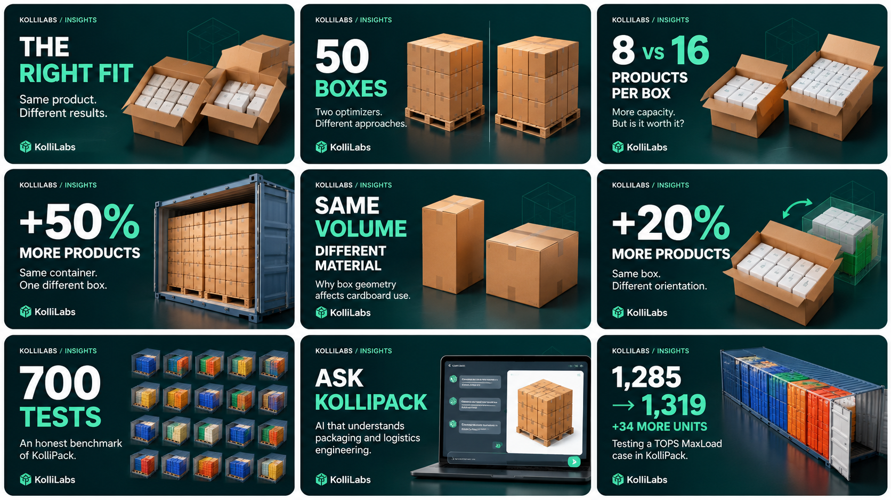
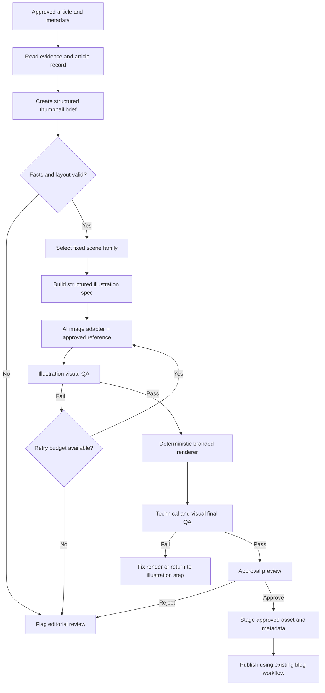

# KolliLabs Blog Thumbnail Design System & Workflow — v1.0

**Status:** Approved visual direction; workflow implementation proposed  
**Date:** 2026-10-20  
**Owner:** KolliLabs  
**Applies to:** Existing and future KolliLabs blog thumbnails, including business articles, engineering deep dives, case studies, and product updates  
**Primary approved visual reference:** [`assets/kollilabs-approved-thumbnail-board-v1.png`](assets/kollilabs-approved-thumbnail-board-v1.png)

> **Non-negotiable:** The accompanying nine-thumbnail collage is the actual design the owner approved. It is the source of visual truth. Do **not** replace it with a separately generated “style-guide” image, generic mood board, or a new aesthetic. The written rules in this document interpret that collage; they do not override it. The board is a visual reference, not proof that pictured product counts, loading geometries, or interfaces correspond to real case-study results.



**Canonical board SHA-256:** `8cbfd1f852273f4a6b20c7e47abb25ffdbd675607fa88c03fa4dd48e46bb547b` (exact original approved file).

## 1. Decision and objective

KolliLabs will retain **AI-generated illustrative imagery** in its blog thumbnails. The goal is an instantly recognizable family of premium, dark-teal, 3D logistics illustrations, not a set of presentation slides or tiny screenshots. The owner does **not** write image prompts manually.

The workflow will combine:

1. An article-grounded, structured creative brief.
2. The *same immutable* approved art direction and style-reference image.
3. AI image generation restricted to the subject illustration.
4. A deterministic design renderer for background, typography, labels, layout and branding.
5. Automated deterministic checks plus image-aware visual QA.
6. Owner approval before replacing currently published thumbnails.

**Success is family resemblance, not pixel-identical AI imagery.** The template is deterministic; image-generation outputs are probabilistic. No text prompt, seed or style reference guarantees a visually identical object or image across model versions.

## 2. What is approved in the reference

The board shows nine examples of **one visual system**: a dark teal-to-near-black studio atmosphere; glossy yet restrained floor/shadow treatment; large white and bright mint typography at the left; carefully lit 3D subjects at the right; small `KOLLILABS / INSIGHTS` brand kicker at upper left; KolliLabs signature in the lower-left; crisp editorial pacing; plenty of negative space; and varied but coherent boxes, pallets, containers, benchmark objects and technology subject matter.

### Fixed tokens (v1 targets)

| Property | Rule |
|---|---|
| Delivery frame | 16:9, default `1280 x 720` pixels |
| Palette | Near-black/deep teal gradient, white, mint-green, restrained neutral grey, natural cardboard brown; final RGB/hex values must be sampled from the approved board and reconciled with existing KolliLabs logo assets |
| Type | A single licensed/repository-available sans-serif family; very bold, legible headline; lighter supporting text; no AI-rendered lettering |
| Branding | `KOLLILABS / INSIGHTS` upper-left and verified KolliLabs wordmark/logo lower-left (fixed positions) |
| Core layout | Short editorial hook left; coherent 3D object scene right; no article's full title in the image |
| Scene | Premium physical/industrial 3D art, convincing scale, materials, shadows and light |
| Camera | Three-quarter or isometric-like product/studio view, avoiding arbitrary fisheye or mixed perspectives |
| Exclusions | People, random infographic decorations, PowerPoint/chart screenshots, generic clip-art, tiny UI screenshots, illegible AI lettering, fake labels, visual clutter |
| Mandatory readability | Recognizable topic, dominant message and article-specific illustration at the rendered blog-card size |

The precise font selection, logo source, margins, gradient values and breakpoint handling must be decided **once** during implementation against the board and existing website styling, then encoded in versioned template tokens rather than re-decided per article.

### Fixed spatial contract

- Top-left: short brand kicker.
- Left ~40–48%: one *main hook* and, optionally, one short clarifying subtitle.
- Right ~52–60%: one AI-generated coherent scene or controlled comparison.
- Lower-left: approved logo/wordmark.
- Do not put important generated subject details behind text, card crops or the bottom logo.
- Allow modest object overlap into the central transition where it matches the approved board, but never compromise legibility.
- Export a layout that remains legible when displayed around **360 × 203 px** and on the website's real mobile card width.

A numerical result may dominate the hook (`+50%`, `700 TESTS`, `1,285 → 1,319`) **only when it is directly supported by the article**. Do not invent outcomes or imply benchmarking superiority where none is established.

## 3. Controlled visual variation

Each article uses the **same layout skeleton and art direction**, choosing exactly one of five scene families. Scene families affect *the illustration*, **not** the placement of the headline, logo or palette.

| Scene family | Subject pattern | Typical articles |
|---|---|---|
| `hero` | One primary box/pallet/container/product concept | Choosing a box, explaining geometry |
| `comparison` | Two subjects with a clean visual distinction | 8-vs-16 boxes, two pallet optimizers |
| `improvement` | One optimized subject or restrained before/after cue | +20%, +50%, +34 units |
| `benchmark` | A tidy grid or series of repeated shipping/pallet/container motifs | 700 cases |
| `product` | Consistent technology/product scene rendered in the same studio language | Ask KolliPack |

A `comparison` scene must **not** become two minuscule screenshots. A `benchmark` scene should convey many evaluations without falsely presenting a sample montage as all 700 results.

## 4. Article-fact and illustrative-integrity rules

There are two distinct image-use modes:

- **Editorial illustration (default):** AI visually communicates the *concept* without purporting to be an exact KolliPack calculation or screenshot. Use in almost all thumbnails; no actual KolliPack render is required.
- **Evidence-derived visualization (opt-in):** Required only where the thumbnail explicitly represents an exact arrangement, dimension, count or comparator result. Supply actual verified geometry/data, retain provenance and check it before release.

Rules:

- Textual metrics and comparisons must be cited to the article's approved facts or editorial evidence, not inferred from an AI picture.
- Do not ask the generator to display exact numbers of *visibly countable* items unless those counts will be independently validated. Prefer metaphorical or non-countable cargo scenes for numeric hooks.
- Never portray a competitor's UI, real loading solution, protected logo, or actual benchmark output as factual if artificially generated.
- AI-generated screenshots and fictitious screen content are prohibited by default; a product-feature article may use an intentional stylized product illustration instead.
- Use meaningful image alt text reflecting the conceptual nature when appropriate, not misleading claims about precise layouts.
- Article facts and calculations remain untouched by the thumbnail workflow.

## 5. Repository organization and integration constraints

**Proposed repo locations** (adjust to the existing repository conventions after inspection):

```text
docs/
  blog/
    thumbnail-design-system-v1.md
    assets/
      kollilabs-approved-thumbnail-board-v1.png
  tasks/
    codex-thumbnail-workflow-refactor-v1.md

<existing-blog-skill-location>/
  SKILL.md                         # Extend existing skill; do not create parallel competing flow
  ...                              # Existing blog instructions and assets stay authoritative

<existing-blog-assets-location>/
  <article-slug>/
    thumbnail-brief.json
    illustration-spec.json
    illustration-v1.png
    thumbnail-v1.webp
    thumbnail-validation.json
    thumbnail-provenance.json
```

Before editing, Codex must locate and read the current thumbnail skill, the overall blog/article-generation skill, article registry/template/schema, research/evidence guidelines, current image assets, and the blog's publishing/storage integration. Preserve all existing article contracts, metadata, routes, social-image conventions and SEO fields unless a separately justified change is needed. No second thumbnail skill or duplicate production system.

## 6. Exact production workflow



### 6.1 Stage A — Article-grounded brief

Input: article body, title, slug, category, editorial metadata, verified quantitative facts and current registry entry. Output: validated `thumbnail-brief.json`.

```json
{
  "schema_version": "1.0",
  "article_slug": "same-box-20-percent-more-products",
  "composition": "improvement",
  "hook_primary": "+20%",
  "hook_secondary": "MORE PRODUCTS",
  "support_line": "Same box. Different orientation.",
  "scene_subject": "single open corrugated box and an alternate product-orientation visual cue",
  "image_mode": "editorial_illustration",
  "supported_claims": [
    { "text": "+20%", "evidence": "approved article: 15 vs 18 products" }
  ],
  "screenshots_allowed": false,
  "reference_standard": "thumbnail-design-system-v1"
}
```

Guardrails: `hook_primary` ideally <= 16 visible characters; `hook_secondary` <= 24; `support_line` <= 66. These are initial layout budgets, not guaranteed fits: renderer must measure actual text and fail/adjust within approved type scales when necessary. If no verified number exists, use an editorial concept hook. Do not silently invent facts to get a catchier headline.

### 6.2 Stage B — Illustration plan

Produce `illustration-spec.json` with scene family, subject inventory, foreground/empty-space zone, materials, camera, lighting, background-blending strategy, avoided artifacts and mode (`editorial_illustration` vs `evidence_derived`). Use the **approved board image** as the same style anchor each time; model/reference-image support must be checked for the selected image-generation adapter, not assumed. Prompt assembly is programmatic and reproducible from a versioned base prompt + family-specific clauses + article variables. Save the fully rendered prompt and prompt-template revision.

### 6.3 Stage C — AI subject generation

- Generate **illustration/scene content**, not article title typography, wordmark, or final complete branded card.
- Prefer an object/scene render with a transparent background *if the selected image API supports reliable alpha*. Otherwise use matching teal studio background, reserved empty space, and deterministic masked/feathered placement without obvious rectangular seams.
- Pass the board as a visual reference when supported. If the provider cannot accept references, identify the limitation, use the pinned descriptive style prompt and increase human QA; never claim that reference-image conditioning happened when it did not.
- Avoid UI screenshots by default.
- Request 1 primary candidate; allow at most 2 extra attempts per thumbnail unless the owner authorizes more. Preserve failures and generation costs/usage when available.
- Do not store API keys, tokens or secrets in article assets, prompts or logs.

### 6.4 Stage D — Image-aware illustration QA

The validator inspects subject legibility, visual compatibility with the reference board, expected scene family, perspective, lighting, clutter, stray text, fake labels, improbable geometry and whether the subject will fit the right-hand image zone.

**Important:** “Looks premium” or “matches reference” is not a fully deterministic machine-testable property. Image-aware automatic review can assist; owner sign-off is the release gate. QA results must include findings and a `pass`, `fail` or `review_required` outcome, not a fabricated objective score.

### 6.5 Stage E — Deterministic branded renderer

A single versioned renderer (SVG, HTML/CSS + screenshot, or equivalent supported by repo) must own **all** brand text, background, sizing, hook line breaks, logo and positions. Rendering the same brief and illustration should produce the same composition (subject to reproducible fonts/runtime). A source image generated with embedded branding/text is rejected, not used as the final card.

Required behavior:

- Exact `1280 × 720` output, using approved layout and tokens.
- Font and logo assets resolved from legitimate available repo assets; never fake the wordmark by free-form AI lettering.
- Deterministic text fitting with size/line-count limits; never hide overflowing words.
- Consistent layering, object scale, contrast and minimum safe area.
- Export preferred production format as used by existing blog pipeline; preserve compatibility with current metadata, responsive crops, OG/social images and caches.

### 6.6 Stage F — Final QA and preview

**Automated hard gates:** file exists/decodes; correct aspect/dimensions; allowed color mode/file size; font and logo available; no text clipping; contrast readable; metadata fields valid; required reference path exists; slug and output paths correct; publisher continues using existing article/image contracts.

**Visual gates:** 3-second comprehension at normal card width; same style family as the nine-tile board; no PPT-style graphs/UI clutter; right-side subject is not tiny; visual is plausible; no unverified factual implication. Visual gates may require manual verification.

**Preview artifacts:** full-size thumbnail, 360px-wide preview, and contact sheet of the pilot thumbnails side-by-side next to reference examples. A generation job must not declare “passed” only because an API call succeeded.

### 6.7 Stage G — Approval, provenance and release

An owner explicitly approves the candidate before any live thumbnail replacement. Store approval state and all provenance: article/asset IDs, source brief, source facts, standard version, reference-asset SHA-256, prompt revision and generated prompt, generator/provider/model as actually used, provider request ID if available, generation time, validation results, cost/attempt count if available, final file checksum and approval status. Never record unsupported model parameters as if they were used.

Write files through the existing blog asset conventions. Do not replace published assets, re-point live article references or change cache keys until owner approval. Keep original thumbnails recoverable with a documented rollback.

## 7. Validation and failure matrix

| Failure | Automated or editorial response |
|---|---|
| Missing API key / image service not available | Stop image generation, show a clear setup issue; renderer/validation can still be tested with local fixture images |
| Generator cannot accept reference image | Log the limitation and use pinned prompt; **visual QA remains mandatory** |
| Wrong typography/logo from AI | Reject illustration; final words and logo must come from code |
| Irrelevant/chaotic objects, inconsistent lighting | Retry with same locked base style and a narrower subject plan; bounded retry budget |
| Fake or misleading visual/count | Reject or reclassify as clearly conceptual and revise subject |
| Text overflow or weak contrast | Fix deterministic layout or shorten hook with editorial approval; do not accept clipped output |
| Comparison too busy | Simplify subjects while retaining the same composition family |
| QA uncertain | `review_required`, not silent auto-publish |
| Failed final rendering | Keep existing published thumbnail; preserve logs and previews |
| Revision of style / model | Bump standard/prompt/template versions; run regression contact-sheet comparison before rollout |

## 8. Implementation phases and approval gates

**Phase 0 — Audit (mandatory, before code):** Inspect current thumbnail skill and blog pipeline. Record gaps, reuse points, image provider capability, current publishing contract, existing test coverage and whether any of the design standard conflicts with repository instructions.

**Phase 1 — Lock standard and renderer:** Commit approved board at agreed path, fix design tokens, implement deterministic card template, schema, and validation with stub/mock illustration. Produce an actual representative card for visual review.

**Phase 2 — AI adapter and QA:** Integrate current/proposed image provider using environment configuration. Generate subject-only illustrations, preserve prompt/reference provenance and bounded retries. Ensure offline tests need no paid generation.

**Phase 3 — Two pilot articles:** Generate independent real thumbnails for (a) the 9,600 → 14,400 / +50% container article, and (b) the 700-test benchmark. These deliberately test two distinct visual families (`improvement` and `benchmark`). Show them together with the approved board and at small rendered size. **Wait for owner approval.**

**Phase 4 — Retrofit existing articles:** After both pilots are approved, run remaining current articles through the same workflow. Stage drafts first. Do not modify existing live thumbnails before approval. Existing nine-article count is based on the owner's 2026-10-20 screenshots and should be re-queried at implementation time.

**Phase 5 — Future default:** Wire existing authoring skill to trigger thumbnail drafting, QA, and approval as a required part of the normal blog workflow. Preserve manual override for exceptional cases, with a documented reason and version.

## 9. Acceptance criteria

The implementation is accepted **only if**:

- The approved original collage is stored in the repo unchanged and used/documented as source of truth.
- Current thumbnail skill is extended/reused; no duplicate incompatible skill or parallel blog stack.
- Text, background, palette, logo placement, typography hierarchy and canvas derive from one deterministic template.
- The owner writes **no** low-level image prompts per article.
- All editorial image scenes use the pinned visual direction, including recurring boxes, pallets and containers; no screenshot dependence.
- Article-specific numbers/hooks are traceable to accepted article facts.
- The two pilot thumbnails exhibit strong side-by-side family resemblance and match the approved board to the owner's satisfaction at full size and at card width.
- Schema tests, template/golden-image checks, fail-closed publishing tests and no-provider offline tests pass.
- The original published thumbnails remain untouched until explicit approval, and rollback is documented.
- Future authors can regenerate a new thumbnail following the same workflow with versioned configuration and transparent provenance.

## 10. Versioning and change control

Version independently: `(design_standard_version, renderer_template_version, base_prompt_version, image_model_id, illustration_asset_version)`.

- **Patch:** bug fix that preserves visual identity (e.g., crop or typo correction).
- **Minor:** approved new object family or composition variant that does not change branding.
- **Major:** background/palette/layout/typography identity change requiring new board and explicit owner approval.

Do not auto-upgrade image models or silently substitute style references. Changes to model availability should trigger a compatibility review and a small regression sample.

### Repository implementation record (2026-10-20)

- Existing skill extended in place: `.agents/skills/blog-article/`.
- Stable CLI retained and refactored: `.agents/skills/blog-article/scripts/compose_thumbnail.py`.
- Shared workflow implementation: `.agents/skills/blog-article/scripts/thumbnail_workflow.py`.
- Versioned renderer tokens and prompt: `.agents/skills/blog-article/assets/`.
- Candidate/pilot location: `artifacts/blog-thumbnail-pilots/`; this is deliberately outside `static/img/blog/` until owner approval.
- Current repository logo limitation: there is no standalone canonical KolliLabs logo asset. The v1 renderer extracts the owner-approved lockup from this board; the image model never renders the logo. Supplying a canonical standalone logo requires a renderer-version bump and visual re-approval.
- Optional API adapter: official OpenAI Images API, pinned by default to `gpt-image-2.5-sunburst-2026-09-08`; reference-image conditioning uses the image-edit endpoint, and transparent PNG is requested. Availability, organization verification, quotas, and cost are account-specific and must be recorded from the actual response.
- Codex built-in generation is also permitted for editorial pilots. Because that tool does not promise to expose the underlying image model or request ID, provenance must record those values as undisclosed/null rather than guessing.
- Reference SHA verified during implementation: `8cbfd1f852273f4a6b20c7e47abb25ffdbd675607fa88c03fa4dd48e46bb547b`.
- Owner approval for the two Phase 3 pilots was recorded on 2026-10-20. The approved bytes were integrated at versioned `thumbnail-v1.webp` paths for `think-beyond-the-box-packaging-flow-case-study` and `container-loading-benchmark-kollipack-br1-br7`; each prior `thumbnail.webp` remains as the rollback asset.
- Phase 4 is incomplete: no approved new-style assets exist for the other seven published articles. They must retain their current thumbnails until candidates are created and explicitly approved; approval of the two pilots must not be generalized to unseen assets.
- Renderer template `1.0.1` increases support-copy typography from 25–31 px to 40–48 px on the 1280×720 master (approximately 11–13.5 px at the 360 px card preview) and permits a controlled four-line maximum for unusually long support copy. This patch responds to owner feedback that the v1 support line was not readable at card size; illustration assets and the wider visual identity are unchanged.

## 11. Non-goals

This v1 does **not** build a KolliLabs customer-facing thumbnail generator, a new backend administration panel, a second article CMS, a bulk autonomous production redeployment, or an automatic rewrite of existing article content. It is a refactor of the existing internal blog-authoring/thumbnails workflow. Existing SEO fields and technically accurate article content are preserved.

## 12. Implementation handoff

Read the companion task at [`../tasks/codex-thumbnail-workflow-refactor-v1.md`](../tasks/codex-thumbnail-workflow-refactor-v1.md). The task instructs Codex to inspect existing repository materials before choosing implementation details. The design board is **approved**; specific code structure, model adapter capabilities, renderer technologies and integration paths are **to be verified in the repository**, not asserted as existing.
