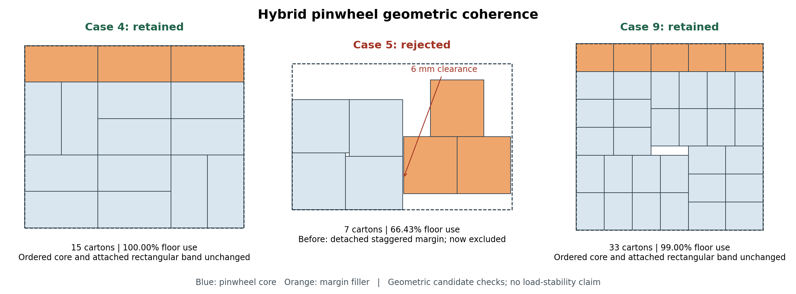

# Hybrid pinwheel geometric calibration

Revision reference: Calibration Cases 4, 5 and 9; PAL-REG-003.
Baseline commit: `4d511fe3fd05ff9a813af6385d19386e424ea0f6`.

## Investigation and acceptance

Case 5's seven-carton Hybrid has a detached, stepped three-carton right
margin, even though floor utilization is 66.43%. Require an attached,
unbroken rectangular margin group before filler construction, then apply
60% floor utilization as a separate relevance check. Preserve Cases 4 and
9's exact ordered coordinates, other families and Container Selection.
No additional candidate searches, widened caps, mechanical simulation or
carton graph is needed. The
[domain contract](../domain/palletization-logic.md#hybrid-pinwheel-calibration)
records the dimensions and arithmetic.



The comparison shows the original primary-orientation layouts. Cases 4 and 9
are unchanged. Case 5 has no Hybrid option after both filters. Its best
existing result remains eight cartons per layer and 56 per pallet.

## Historical fixture deltas

The frozen `palletization_stage2_baseline.json` is unchanged. A compatibility
run disables both calibrated eligibility policies and must match every original
coordinate, stack, serialized row, scene and report entry. The production-policy
run permits only these additional explicit Hybrid changes; earlier Nested
Pinwheel deltas remain protected separately.

| Pattern fixture | Orientation | Before → after | Reason for excluding the old candidate |
| --- | --- | ---: | --- |
| splitrow_tops | Primary | 8 → 0 | Split balanced top band |
| splitrow_na4840 | Alternate | 22 → 0 | Staggered right margin |
| splitrow_compact_filler | Primary | 22 → 20 | Split balanced top band; coherent bare core retained |
| splitrow_sparse_362 | Primary | 21 → 16 | Split balanced top band; coherent bare core retained |
| splitrow_sparse_364 | Primary | 9 → 0 | Split balanced top band |
| container_reference | Primary | 5 → 0 | Split balanced top band; 54.63% utilization also below relevance floor |
| near_square_carton | Primary | 15 → 0 | Split balanced top band |
| near_square_carton | Alternate | 14 → 0 | 58.63% utilization; filled candidates also split |
| beyond_shared_parameter_cap | Primary | 342 → 340 | Split balanced top band; coherent bare core retained |
| significant_residual | Primary | 13 → 0 | Split balanced top band |

Complete-analysis fixtures remove only the eight-carton Hybrid row in
`tops_splitrow_overhang` and the five-carton Hybrid row in
`container_reference_geometry`. Other rows, selected results, scene data and
report values must remain exact. A geometric filter can exclude a layout
with high utilization: the old 342-carton result has 99.75% floor use but a
split margin. The 340-carton coherent alternative remains available.

This is deliberately conservative about Hybrid margins. It does not reject
all asymmetry: attached partial rectangular grids remain valid in the
unbalanced alternate orientation. It makes no assertion about real load
stability or handling safety. The independent Brick family is unchanged.

## Consumer assessment

| Consumer | Verification |
| --- | --- |
| Standalone Palletization | All calibration links calculate, select and recalculate; Case 5 has no Hybrid; Cases 4/9 keep 15/33 per layer |
| Packaging Flow | Cases 4/5/9 have matching shared table fields and selected results; workflow footprint metadata remains present; JSON serialization passes |
| Public SEO calculator | Same Cases 4/5/9 availability, selection, scene geometry and export summary; defaults covered separately |
| PDF/report | Frozen Stage 2 report rows remain exact after named removals; selected serialized export matches the visible result; existing PDF builder and metric-path tests run |
| JavaScript/graphics | No schema or JavaScript changes; shared scene placements pass bounds, count and no-overlap assertions; ordered positive-case coordinates retained; comparison figure inspected |
| Catalogue | Same dimensions and shared service path; existing catalogue/height/payload tests run |
| Container Selection | Policy remains off; Stage 1 exact enumeration/selection fixture and Container input/result suites run |
| Multi-product Container | No policy, service, aggregation or renderer change; consumes the unchanged Container Selection path |
| Multi-product Bag | Not applicable; no dependency on Palletization pattern eligibility |
| Session state | New flag stays in immutable Python policy configuration; no new session fields or objects; JSON serialization checked |

No browser interaction or production system was needed for this engine-only
change. Test requests render the shared templates and inspect scene contracts.

## Benchmark

`packagingapp.tests.benchmark_hybrid_pinwheel` loads the original core from the
baseline commit in a separate module, alternates before/after calls, and reports
medians from seven repetitions in the same local Python environment. It checks
all non-Hybrid full-analysis rows, including ordered stack geometry, for exact
equality. A pre-edit three-repeat run was also captured locally before modifying
the core. Timing is observational, not a CI performance guarantee.

| Case | Primary Hybrid before → after, ms | Full analysis before → after, ms |
| --- | ---: | ---: |
| Calibration 4 | 1.348 → 0.946 | 21.096 → 20.562 |
| Calibration 5 | 0.102 → 0.029 | 11.986 → 6.592 |
| Calibration 9 | 14.676 → 5.865 | 123.938 → 116.701 |
| Standard 230 × 170 | 8.142 → 3.231 | 95.084 → 75.705 |
| Fractional 73.2 × 41.7 | 22.905 → 10.613 | 163.172 → 140.071 |
| Small 70 × 40 | 2826.776 → 1842.436 | 12613.994 → 9819.050 |

Both orientations were benchmarked. All 18 measured paths had no material
regression under the existing >20% and >25 ms combined criterion. Search caps
remain 30 parameters/80 materialized pinwheel candidates for Palletization and
12/8 for Container Selection. Eligibility adds constant-time arithmetic per
existing core after its existing bounding-box scan, and avoids rejected filler
construction/validation and downstream stacks. No enumeration is added.

[Raw paired benchmark](../../artifacts/palletization-hybrid-calibration/benchmark.json)
and [pre-edit capture](../../artifacts/palletization-hybrid-calibration/benchmark-before.json).

```powershell
.\.venv\Scripts\python.exe -m packagingapp.tests.benchmark_hybrid_pinwheel --repetitions 7
```

## Regression verification

The pre-edit cumulative baseline passed **133 tests** in 122.219 seconds.
Run the same command after editing; it includes the new Hybrid and shared
consumer regressions automatically:

```powershell
$env:DEBUG='True'
.\.venv\Scripts\python.exe manage.py test packagingapp.tests.test_shared_mosaic_patterns packagingapp.tests.test_shared_mosaic_stage1_baseline packagingapp.tests.test_palletization_stage2_baseline packagingapp.tests.test_nested_simple_lattice_patterns packagingapp.tests.test_pallet_splitrow packagingapp.tests.test_pallet_max_load packagingapp.tests.test_palletization_unit_ui packagingapp.tests.test_regressions.RegressionCompendiumTests packagingapp.tests.test_product_dimensional_allowance packagingapp.tests.test_container_geometry_first packagingapp.tests.test_full_packaging_case --noinput
.\.venv\Scripts\python.exe manage.py check
git diff --check
```

Final cumulative result: **140 tests passed**, zero failures and zero skips,
in 99.025 seconds. The 133-test baseline and 140-test final commands use the
same module list; the difference is six geometric regression methods and one
consumer integration method. The focused seven-test Hybrid/consumer check
also passed. `manage.py check` reported no issues and `git diff --check` passed.
The existing missing-`staticfiles` warning is unrelated to this change.

Final diff review found only the requested Hybrid policy, regression protection,
benchmark and explanatory evidence. No commit, push, merge, deployment,
production migration or production data change was performed.

## Changed files

- `packagingapp/utils/packing_patterns/core.py`: Palletization-only policy,
  arithmetic margin preflight and separate relevance filter.
- `packagingapp/tests/test_shared_mosaic_patterns.py`: geometric regressions,
  secondary-filter independence, preconstruction rejection, unit boundaries,
  policy isolation and policy-aware delegation parity.
- `packagingapp/tests/test_palletization_stage2_baseline.py`: explicit named
  Hybrid deltas while retaining the immutable compatibility comparison.
- `packagingapp/tests/test_regressions.py`: calibration availability and
  standalone/SEO/Flow selection, scene, export and session contracts.
- `packagingapp/tests/benchmark_hybrid_pinwheel.py`: reproducible paired timings
  against the locked original core, plus non-Hybrid analysis equality checks.
- `docs/domain/palletization-logic.md`, `docs/domain/shared-mosaic-patterns.md`,
  `docs/engineering/known-issues-and-regressions.md`, and this report: contract,
  investigation, cumulative register and evidence.
- `artifacts/palletization-hybrid-calibration/`: benchmark captures and inspected
  comparison figure.
